+++
date = '2026-10-26T16:25:59-03:00'
draft = false
title = 'Exceptional Control Flow'
type = 'blog'
tags = ['Arquitetura', 'Sistemas Operacionais', 'CSAPP']
+++

Do momento em que o computador é ligado até o momento em que é desligado, o *program counter* (PC) assume uma sequência de valores, cada um sendo o endereço de uma instrução. A passagem de um endereço para o próximo é chamada de **transferência de controle**, e a sequência inteira dessas transferências é o **fluxo de controle** (*control flow*) do processador.

O tipo mais simples de fluxo de controle é o "suave", em que cada instrução executada está logo depois da anterior na memória. Mudanças bruscas nesse fluxo, em que a próxima instrução não é a vizinha da atual, já são conhecidas: são causadas por instruções como **jumps**, **calls** e **returns**. Esses mecanismos permitem que o programa reaja a mudanças no seu próprio estado, representado pelas suas variáveis.

Só que o sistema também precisa reagir a mudanças que **não têm nada a ver com as variáveis do programa** e que muitas vezes nem estão relacionadas à execução dele. Alguns exemplos:

- Um timer de hardware dispara em intervalos regulares e isso precisa ser tratado.
- Pacotes chegam pela placa de rede e precisam ser guardados na memória.
- Um programa pede dados do disco e fica dormindo até ser avisado de que eles chegaram.
- Um processo pai que criou processos filhos precisa ser avisado quando um deles termina.

Os sistemas modernos reagem a essas situações fazendo mudanças bruscas no fluxo de controle. Essas mudanças são chamadas, em geral, de **exceptional control flow** (ECF), e elas acontecem em todos os níveis de um sistema computacional:

- **No hardware:** eventos detectados pelo hardware fazem o controle ser transferido para rotinas chamadas de *exception handlers*.
- **No sistema operacional:** o kernel transfere o controle de um processo para outro por meio das **trocas de contexto** (*context switches*).
- **Na aplicação:** um processo pode enviar um **sinal** para outro, fazendo o controle do processo que recebe ir para um *signal handler*.
- **Dentro de um programa:** um programa pode reagir a erros pulando para fora da disciplina normal da pilha, fazendo **saltos não locais** (*nonlocal jumps*) para pontos arbitrários de outras funções.

## Exceções

**Exceções** são uma forma de exceptional control flow implementada em parte pelo hardware e em parte pelo sistema operacional. Como uma parte fica no hardware, os detalhes mudam de um sistema para outro, mas a ideia básica é a mesma em todos.

> Em C++ e Java, a palavra "exceção" também é usada para o mecanismo de `try`, `catch` e `throw`. Para ser bem preciso, daria para separar exceções "de hardware" e "de software", mas normalmente o contexto já deixa claro de qual delas se está falando.

Uma exceção é uma **mudança brusca no fluxo de controle em resposta a alguma mudança no estado do processador**. Esse estado fica guardado em vários bits e sinais dentro do processador, e uma mudança nele é chamada de **evento**.

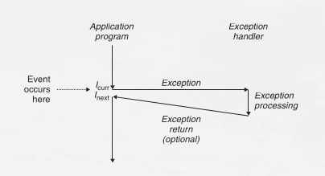

Na figura, o processador está executando uma instrução, chamada de \(I_{curr}\), quando acontece um evento. Esse evento pode estar:

- **Ligado à instrução atual:** por exemplo, uma *page fault* na memória virtual, um overflow aritmético ou uma divisão por zero.
- **Sem relação com a instrução atual:** por exemplo, o timer do sistema dispara ou uma operação de I/O termina.

Seja qual for o caso, quando o processador percebe que o evento aconteceu, ele faz uma **chamada de procedimento indireta** (a exceção), usando uma tabela de saltos chamada de **tabela de exceções** (*exception table*), para uma rotina do sistema operacional feita especificamente para tratar aquele tipo de evento: o **exception handler**.

Quando o handler termina, uma de três coisas acontece, dependendo do tipo de evento:

1. O handler devolve o controle para \(I_{curr}\), a instrução que estava sendo executada quando o evento aconteceu.
2. O handler devolve o controle para \(I_{next}\), a instrução que seria executada em seguida se a exceção não tivesse acontecido.
3. O handler aborta o programa interrompido.

### Tratamento de exceções

Tratar uma exceção exige que o hardware e o software trabalhem juntos, e é fácil se confundir sobre quem faz o quê.

Cada tipo de exceção possível no sistema recebe um **número de exceção**, um inteiro não negativo e único. Uma parte desses números é definida pelos projetistas do processador, e a outra pelos projetistas do **kernel** do sistema operacional (a parte dele que fica sempre na memória):

- **Definidas pelo processador:** divisão por zero, page faults, acessos inválidos à memória, *breakpoints* e overflows aritméticos.
- **Definidas pelo sistema operacional:** system calls e sinais vindos de dispositivos de I/O externos.

Quando o computador é ligado ou reiniciado, o sistema operacional cria e preenche a tabela de exceções, de forma que a entrada *k* guarde o endereço do handler da exceção *k*. Depois, com o sistema rodando, **quando o processador detecta um evento, ele descobre o número de exceção *k* correspondente e dispara a exceção, fazendo uma chamada indireta pela entrada *k* da tabela até o handler**. O endereço inicial da tabela fica em um registrador especial do processador, o **exception table base register**, e o número da exceção funciona como índice: o processador soma o endereço inicial com *k* vezes 8 (o tamanho de cada entrada) para achar a entrada certa.

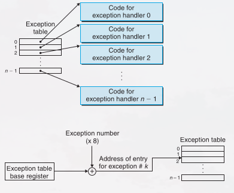

Uma exceção parece uma chamada de procedimento, mas tem algumas diferenças importantes:

- **O endereço de retorno pode variar.** Como numa chamada de procedimento, o processador empilha um endereço de retorno antes de pular para o handler. Só que, dependendo do tipo de exceção, esse endereço é o da instrução atual (\(I_{curr}\)) ou o da próxima (\(I_{next}\)).
- **Mais estado é salvo.** O processador também empilha outras informações necessárias para retomar o programa depois. No x86-64, por exemplo, ele empilha o registrador **EFLAGS**, que guarda os condition codes atuais.
- **A pilha usada é a do kernel.** Quando o controle passa de um programa do usuário para o kernel, tudo isso é empilhado na pilha do kernel, e não na pilha do usuário.
- **O handler roda em modo kernel** (*kernel mode*), ou seja, tem acesso total a todos os recursos do sistema.

Depois que o hardware dispara a exceção, o resto do trabalho é feito em software pelo handler. Quando termina de tratar o evento, o handler pode voltar para o programa interrompido executando uma instrução especial de **retorno de interrupção** (*return from interrupt*). Ela desempilha o estado salvo de volta para os registradores do processador, volta para o **modo usuário** (*user mode*) se a exceção interrompeu um programa do usuário e devolve o controle ao programa.

### Classes de exceções

As exceções se dividem em quatro classes: **interrupções** (*interrupts*), **traps**, **faults** e **aborts**.

| Classe | Causa | Assíncrona/síncrona | Para onde volta |
|---|---|---|---|
| Interrupção | Sinal de um dispositivo de I/O | Assíncrona | Sempre para a próxima instrução |
| Trap | Exceção intencional | Síncrona | Sempre para a próxima instrução |
| Fault | Erro possivelmente recuperável | Síncrona | Pode voltar para a instrução atual |
| Abort | Erro irrecuperável | Síncrona | Nunca volta |

As exceções **assíncronas** são causadas por eventos em dispositivos de I/O fora do processador, e as **síncronas** são consequência direta da execução de uma instrução.

#### Interrupções

As interrupções acontecem de forma **assíncrona**, a partir de sinais de dispositivos de I/O externos ao processador. Elas são assíncronas porque não são causadas pela execução de nenhuma instrução específica. Os handlers delas costumam ser chamados de **interrupt handlers**.

Dispositivos como placas de rede, controladoras de disco e chips de timer disparam uma interrupção sinalizando um pino do processador e colocando no barramento do sistema o número de exceção que identifica o dispositivo.


Quando a instrução atual termina, o processador percebe que o pino foi ativado, lê o número de exceção do barramento e chama o interrupt handler certo. Ao terminar, o handler devolve o controle para a próxima instrução, e **o programa continua como se a interrupção nunca tivesse acontecido**.

As outras três classes (traps, faults e aborts) acontecem de forma **síncrona**, como resultado da execução da instrução atual, que é chamada de **faulting instruction**.

#### Traps e system calls

Traps são exceções **intencionais**, que acontecem como resultado da execução de uma instrução. Assim como nas interrupções, o handler devolve o controle para a próxima instrução. O uso mais importante das traps é oferecer uma interface parecida com uma chamada de procedimento entre os programas do usuário e o kernel: a **system call**.

Os programas do usuário muitas vezes precisam pedir serviços ao kernel, como ler um arquivo (`read`), criar um processo (`fork`), carregar um novo programa (`execve`) ou terminar o processo atual (`exit`). Para dar acesso controlado a esses serviços, o processador oferece uma instrução especial `syscall n`, que o programa executa quando quer pedir o serviço *n*. Essa instrução causa uma trap para um handler que interpreta o argumento e chama a rotina certa do kernel.

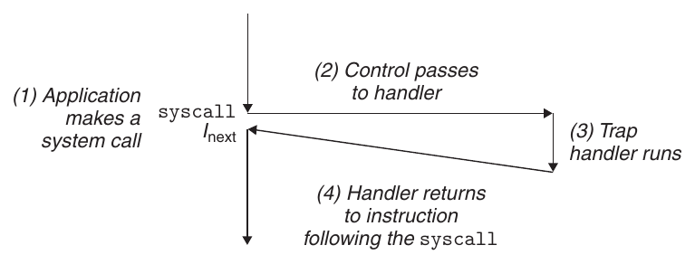

Para o programador, uma system call é igual a uma chamada de função comum, mas a implementação é bem diferente. Uma função comum roda em **modo usuário**, que limita os tipos de instrução que ela pode executar, e usa a mesma pilha de quem a chamou. Uma system call roda em **modo kernel**, o que permite executar instruções privilegiadas e usar uma pilha que fica no kernel.

#### Faults

Faults vêm de erros que o handler **talvez consiga corrigir**. Quando acontece uma fault, o processador passa o controle para o fault handler. Se ele consegue corrigir o erro, devolve o controle para a faulting instruction, que é executada de novo. Se não consegue, o handler passa o controle para uma rotina `abort` do kernel, que termina o programa que causou a fault.

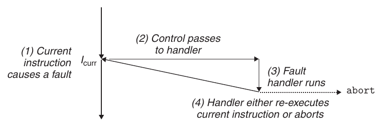

O exemplo clássico é a **page fault**, que acontece quando uma instrução usa um endereço virtual cuja página não está na memória e precisa ser buscada no disco. Uma página é um bloco contínuo de memória virtual, normalmente de 4 KB. O page fault handler carrega a página do disco e devolve o controle para a instrução que causou a fault. Quando ela roda de novo, a página já está na memória e a instrução termina normalmente.

#### Aborts

Aborts vêm de **erros fatais irrecuperáveis**, normalmente erros de hardware, como erros de paridade quando bits da DRAM ou da SRAM são corrompidos. O abort handler nunca devolve o controle para o programa: ele passa o controle para uma rotina `abort`, que termina o programa.

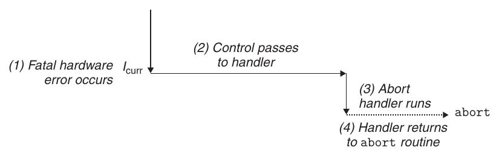

### Exceções no Linux/x86-64

Nos sistemas x86-64 existem até 256 tipos de exceção. Os números de 0 a 31 são definidos pelos arquitetos da Intel e, por isso, são iguais em qualquer sistema x86-64. Os números de 32 a 255 são interrupções e traps definidas pelo sistema operacional. Alguns exemplos:

| Número | Descrição | Classe |
|---|---|---|
| 0 | Erro de divisão | Fault |
| 13 | General protection fault | Fault |
| 14 | Page fault | Fault |
| 18 | Machine check | Abort |
| 32–255 | Exceções definidas pelo sistema operacional | Interrupção ou trap |

#### System calls no Linux/x86-64

O Linux oferece centenas de system calls, que os programas usam quando precisam pedir algum serviço ao kernel, como ler ou escrever um arquivo ou criar um processo. Cada system call tem um número único, que corresponde a uma posição em uma tabela de saltos dentro do kernel (essa tabela não é a mesma tabela de exceções). Algumas das mais usadas:

| Número | Nome | Descrição |
|---|---|---|
| 0 | `read` | Lê um arquivo |
| 1 | `write` | Escreve em um arquivo |
| 2 | `open` | Abre um arquivo |
| 3 | `close` | Fecha um arquivo |
| 4 | `stat` | Pega informações sobre um arquivo |
| 9 | `mmap` | Mapeia uma página de memória para um arquivo |
| 12 | `brk` | Muda o topo do heap |
| 32 | `dup2` | Copia um descritor de arquivo |
| 33 | `pause` | Suspende o processo até chegar um sinal |
| 37 | `alarm` | Agenda o envio de um sinal de alarme |
| 39 | `getpid` | Pega o ID do processo |
| 57 | `fork` | Cria um processo |
| 59 | `execve` | Executa um programa |
| 60 | `_exit` | Termina o processo |
| 61 | `wait4` | Espera um processo terminar |
| 62 | `kill` | Envia um sinal para um processo |

Um programa em C pode chamar qualquer system call diretamente com a função `syscall`, mas na prática isso quase nunca é necessário. A biblioteca padrão de C oferece **funções wrapper** para a maioria das system calls: elas preparam os argumentos, fazem a trap para o kernel com a instrução da system call certa e devolvem o resultado para o programa. Por isso, as system calls e os seus wrappers são chamados, de forma geral, de **funções de nível de sistema** (*system-level functions*).

No x86-64, as system calls são feitas pela instrução de trap `syscall`. Todos os argumentos são passados por **registradores**, e não pela pilha:

- `%rax` guarda o número da system call.
- Até seis argumentos vão, em ordem, em `%rdi`, `%rsi`, `%rdx`, `%r10`, `%r8` e `%r9`.
- Na volta, `%rcx` e `%r11` são destruídos, e `%rax` guarda o valor de retorno. Um valor negativo entre −4.095 e −1 indica um erro, que corresponde ao `errno` com o sinal trocado.

## Processos

As exceções são a base que permite ao kernel do sistema operacional oferecer a ideia de **processo**, uma das ideias mais importantes e bem-sucedidas da computação.

Quando rodamos um programa em um sistema moderno, temos a **ilusão de que ele é o único rodando no sistema**. O programa parece ter uso exclusivo do processador e da memória: o processador parece executar as instruções dele uma atrás da outra, sem interrupção, e o código e os dados dele parecem ser as únicas coisas na memória. Quem cria essas ilusões é o processo.

A definição clássica de processo é **uma instância de um programa em execução**. Todo programa roda no **contexto** de algum processo, que é o estado de que o programa precisa para funcionar: o código e os dados dele na memória, a pilha, o conteúdo dos registradores de uso geral, o program counter, as variáveis de ambiente e o conjunto de descritores de arquivo abertos.

Toda vez que um usuário roda um programa digitando o nome de um executable object file no shell, **o shell cria um novo processo e roda o executável no contexto desse processo**. Os próprios programas também podem criar novos processos e rodar neles o seu código ou outros programas.

Em vez de entrar em como o sistema operacional implementa os processos, o foco aqui são as duas abstrações principais que um processo oferece:

- Um **fluxo de controle lógico** independente, que dá a ilusão de que o programa usa o processador sozinho.
- Um **espaço de endereçamento privado**, que dá a ilusão de que o programa usa a memória sozinho.

### Fluxo de controle lógico

Um processo dá a cada programa a ilusão de usar o processador sozinho, mesmo com vários outros programas rodando ao mesmo tempo. Se executássemos o programa passo a passo em um debugger, veríamos uma sequência de valores do PC que correspondem só a instruções do nosso executável ou das shared libraries ligadas a ele. Essa sequência é o **fluxo de controle lógico** (*logical control flow*), ou só **fluxo lógico**.

Imagine um sistema que roda três processos. O único fluxo de controle físico do processador é dividido em três fluxos lógicos, um para cada processo. Cada barra vertical da figura é um pedaço do fluxo lógico de um processo:

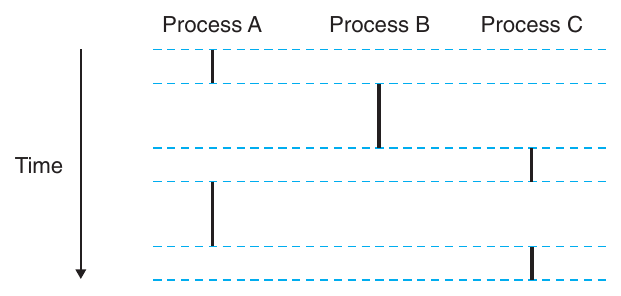

No exemplo, os três fluxos se intercalam: A roda um pouco, depois B roda até terminar, C roda um pouco, A volta e termina, e por fim C roda até terminar.

O ponto principal é que **os processos se revezam no processador**. Cada um executa um pedaço do seu fluxo e depois é **preemptado** (suspenso temporariamente) enquanto os outros têm a sua vez. Para o programa, parece que ele usa o processador sozinho. A única pista do contrário é que, medindo com precisão o tempo de cada instrução, daria para notar que a CPU parece travar de vez em quando entre algumas instruções. Mas, sempre que isso acontece, o programa volta a rodar sem nenhuma mudança na memória nem nos registradores dele.

### Fluxos concorrentes

Fluxos lógicos aparecem de várias formas: exception handlers, processos, signal handlers e threads são todos exemplos.

Um fluxo lógico cuja execução se sobrepõe no tempo à de outro é chamado de **fluxo concorrente**, e os dois **rodam concorrentemente**. Ou seja, dois fluxos são concorrentes quando um começa depois do outro começar e antes de ele terminar. Na figura anterior, A e B são concorrentes, assim como A e C. Já B e C não são, porque a última instrução de B acontece antes da primeira de C.

Esse fenômeno de vários fluxos rodando concorrentemente é a **concorrência**. A ideia de um processo se revezar com outros também é chamada de **multitarefa** (*multitasking*), e cada período em que um processo executa um pedaço do seu fluxo é uma **fatia de tempo** (*time slice*). Na figura, o fluxo de A tem duas fatias de tempo.

A concorrência não depende do número de núcleos ou de computadores: se dois fluxos se sobrepõem no tempo, eles são concorrentes, mesmo rodando no mesmo processador. Quando dois fluxos concorrentes rodam em **núcleos ou computadores diferentes**, eles são chamados de **fluxos paralelos**: rodam em paralelo e têm **execução paralela**.

### Espaço de endereçamento privado

Um processo também dá a cada programa a ilusão de usar sozinho o espaço de endereçamento do sistema. Em uma máquina com endereços de *n* bits, o **espaço de endereçamento** é o conjunto dos \(2^n\) endereços possíveis, de 0 a \(2^n - 1\). Cada processo tem o seu próprio **espaço de endereçamento privado**: privado porque um byte de memória ligado a um endereço desse espaço, em geral, não pode ser lido nem escrito por nenhum outro processo.

O conteúdo da memória de cada espaço privado é diferente, mas a organização é sempre a mesma. No Linux x86-64, ela é assim:


A parte de baixo do espaço de endereçamento é reservada para o programa do usuário, com os segmentos de código, dados, heap e pilha. O segmento de código sempre começa no endereço `0x400000`. A parte de cima é reservada para o **kernel**, e guarda o código, os dados e a pilha que o kernel usa quando executa instruções em nome do processo (por exemplo, quando o programa faz uma system call).

### Modo usuário e modo kernel

Para o kernel conseguir oferecer uma abstração de processo sem brechas, o processador precisa de um mecanismo que limite as instruções que um programa pode executar e as partes do espaço de endereçamento que ele pode acessar.

Normalmente, isso é feito com um **bit de modo** (*mode bit*) em algum registrador de controle, que diz quais privilégios o processo tem no momento:

- **Com o bit ligado, o processo está em modo kernel** (também chamado de *supervisor mode*). Ele pode executar qualquer instrução e acessar qualquer posição de memória do sistema.
- **Com o bit desligado, o processo está em modo usuário.** Ele não pode executar **instruções privilegiadas**, como parar o processador, mudar o bit de modo ou iniciar uma operação de I/O, nem acessar diretamente o código ou os dados da área do kernel. Qualquer tentativa causa uma fault de proteção fatal. Para usar o código e os dados do kernel, o programa precisa passar pela interface de system calls.

Um processo que roda código de aplicação começa em modo usuário. **A única forma de ele passar para o modo kernel é por meio de uma exceção**, como uma interrupção, uma fault ou uma system call. Quando a exceção acontece e o controle vai para o handler, o processador muda para o modo kernel. O handler roda em modo kernel e, quando devolve o controle para a aplicação, o processador volta para o modo usuário.

O Linux tem um mecanismo interessante, o sistema de arquivos **`/proc`**, que permite a processos em modo usuário ler estruturas de dados do kernel. Ele exporta o conteúdo de muitas dessas estruturas como uma hierarquia de arquivos de texto. Dá para ver, por exemplo, o tipo da CPU (`/proc/cpuinfo`) ou os segmentos de memória usados por um processo (`/proc/<process-id>/maps`). A versão 2.6 do kernel também trouxe o sistema de arquivos **`/sys`**, com mais informações de baixo nível sobre barramentos e dispositivos.

### Trocas de contexto

O kernel implementa a multitarefa com uma forma de ECF de mais alto nível, a **troca de contexto** (*context switch*), que é construída em cima das exceções de baixo nível vistas antes.

O kernel guarda um **contexto** para cada processo, que é o estado de que ele precisa para retomar um processo preemptado. Esse contexto inclui os registradores de uso geral e de ponto flutuante, o program counter, a pilha do usuário, os registradores de status, a pilha do kernel e várias estruturas de dados do kernel, como a **tabela de páginas** (que descreve o espaço de endereçamento), a **tabela de processos** (com informações sobre o processo atual) e a **tabela de arquivos** (com os arquivos que o processo abriu).

Em certos momentos, o kernel pode decidir preemptar o processo atual e retomar um que tinha sido preemptado antes. Essa decisão se chama **escalonamento** (*scheduling*) e é feita por uma parte do kernel chamada **escalonador** (*scheduler*). Depois de escolher um novo processo, o kernel faz a troca de contexto, que:

1. Salva o contexto do processo atual.
2. Restaura o contexto salvo de algum processo preemptado antes.
3. Passa o controle para esse processo restaurado.

Uma troca de contexto pode acontecer:

- **Durante uma system call.** Se a system call bloqueia porque precisa esperar algum evento, o kernel pode colocar o processo para dormir e trocar para outro. Por exemplo, se um `read` precisa acessar o disco, o kernel pode rodar outro processo em vez de esperar os dados chegarem. A system call `sleep` é um pedido explícito para colocar o processo para dormir. Mesmo quando a system call não bloqueia, o kernel pode decidir trocar de contexto em vez de voltar para o processo que a chamou.
- **Por causa de uma interrupção.** Todo sistema tem algum mecanismo que gera interrupções de timer periódicas, normalmente a cada 1 ms ou 10 ms. A cada interrupção, o kernel pode decidir que o processo atual já rodou tempo suficiente e trocar para outro.

A figura mostra um exemplo de troca de contexto entre dois processos, A e B:

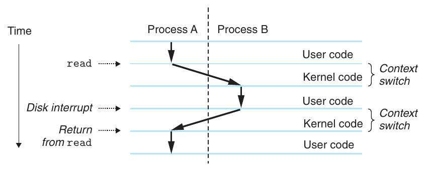

No começo, o processo A está rodando em modo usuário até que faz uma trap para o kernel com a system call `read`. O trap handler pede uma transferência DMA à controladora de disco e configura o disco para interromper o processador quando os dados tiverem sido copiados para a memória.

Como o disco vai demorar bastante (na ordem de dezenas de milissegundos), o kernel troca de contexto do processo A para o B em vez de ficar esperando. **Antes da troca, o kernel está executando instruções em modo usuário em nome do processo A** (não existe um processo do kernel separado). Durante a primeira parte da troca, o kernel executa instruções em modo kernel em nome de A; em algum momento, passa a executar instruções (ainda em modo kernel) em nome de B; e depois da troca, executa instruções em modo usuário em nome de B.

O processo B roda um tempo em modo usuário até que o disco envia uma interrupção avisando que os dados chegaram à memória. O kernel decide que B já rodou o bastante e troca de contexto de B para A, devolvendo o controle para a instrução logo depois do `read`. O processo A continua rodando até a próxima exceção, e assim por diante.

## Tratamento de erros em system calls

Quando as funções de nível de sistema do Unix encontram um erro, normalmente elas **retornam −1** e colocam na variável global inteira **`errno`** um valor que diz o que deu errado. O programador deveria sempre verificar esses erros, mas muitos pulam essa parte porque ela deixa o código maior e mais difícil de ler. Por exemplo, verificar erros ao chamar o `fork` fica assim:

```c
if ((pid = fork()) < 0) {
    fprintf(stderr, "fork error: %s\n", strerror(errno));
    exit(0);
}
```

A função `strerror` devolve um texto que descreve o erro correspondente a um valor de `errno`. Dá para simplificar um pouco esse código com uma função que reporta o erro:

```c
void unix_error(char *msg) /* Unix-style error */
{
    fprintf(stderr, "%s: %s\n", msg, strerror(errno));
    exit(0);
}
```

Com ela, a chamada ao `fork` cai de quatro linhas para duas:

```c
if ((pid = fork()) < 0)
    unix_error("fork error");
```

Dá para simplificar ainda mais com **wrappers de tratamento de erro**. Para uma função `foo`, define-se um wrapper `Foo`, com os mesmos argumentos e o nome com a primeira letra maiúscula. O wrapper chama a função original, verifica se houve erro e termina o programa se algo deu errado. O wrapper do `fork`, por exemplo, é:

```c
pid_t Fork(void)
{
    pid_t pid;

    if ((pid = fork()) < 0)
        unix_error("Fork error");
    return pid;
}
```

E a chamada ao `fork` vira uma única linha:

```c
pid = Fork();
```

O livro usa esses wrappers no resto dos exemplos, para deixar o código curto **sem dar a impressão de que é aceitável ignorar a verificação de erros**. Mesmo assim, no texto as funções são sempre chamadas pelo nome original, em minúsculas (`fork`, e não `Fork`). Os wrappers ficam no arquivo `csapp.c`, com os protótipos em `csapp.h`, disponíveis no site do CS:APP.

## Controle de processos

O Unix oferece várias system calls para manipular processos a partir de programas em C. Esta parte mostra as principais e exemplos de uso.

### Obtendo o ID de um processo

Todo processo tem um **ID de processo** (PID) único e positivo. A função `getpid` devolve o PID do processo que a chamou, e `getppid` devolve o PID do **pai** dele (o processo que o criou):

```c
#include <sys/types.h>
#include <unistd.h>

pid_t getpid(void);
pid_t getppid(void);
```

As duas devolvem um valor do tipo `pid_t`, que no Linux é definido em `types.h` como um `int`.

### Criando e terminando processos

Para o programador, um processo está sempre em um de três estados:

- **Rodando** (*running*): está executando na CPU ou esperando para ser executado, e em algum momento vai ser escalonado pelo kernel.
- **Parado** (*stopped*): a execução está suspensa e ele não vai ser escalonado. Um processo para quando recebe um dos sinais `SIGSTOP`, `SIGTSTP`, `SIGTTIN` ou `SIGTTOU`, e continua parado até receber um `SIGCONT`, quando volta a rodar. (Sinais são uma espécie de interrupção de software, vistos mais à frente.)
- **Terminado** (*terminated*): o processo parou para sempre. Isso acontece por um de três motivos: ele recebeu um sinal cuja ação padrão é terminar o processo, retornou da `main` ou chamou a função `exit`.

```c
#include <stdlib.h>

void exit(int status);
```

A função `exit` termina o processo com o **status de saída** `status`, e não retorna. A outra forma de definir o status de saída é retornar um inteiro da `main`.

Um processo **pai** cria um novo processo **filho** chamando a função `fork`:

```c
#include <sys/types.h>
#include <unistd.h>

pid_t fork(void);
```

O filho é quase idêntico ao pai. Ele recebe uma **cópia idêntica, mas separada**, do espaço de endereçamento do pai no nível do usuário (código, dados, heap, shared libraries e pilha), e também cópias de todos os descritores de arquivo abertos, então pode ler e escrever em qualquer arquivo que estava aberto no pai na hora do `fork`. A diferença mais importante entre os dois é que eles têm **PIDs diferentes**.

O `fork` é interessante (e muitas vezes confuso) porque **é chamado uma vez, mas retorna duas**: uma no processo que o chamou (o pai) e outra no filho recém-criado. No pai, o `fork` devolve o PID do filho. No filho, devolve 0. Como o PID do filho nunca é zero, o valor de retorno diz sem ambiguidade se o código está rodando no pai ou no filho. Em caso de erro, devolve −1.

No exemplo abaixo, o pai usa o `fork` para criar um filho. Quando o `Fork` retorna, `x` vale 1 tanto no pai quanto no filho. O filho incrementa e imprime a sua cópia de `x`, e o pai decrementa e imprime a dele:

```c
int main()
{
    pid_t pid;
    int x = 1;

    pid = Fork();
    if (pid == 0) { /* Child */
        printf("child : x=%d\n", ++x);
        exit(0);
    }

    /* Parent */
    printf("parent: x=%d\n", --x);
    exit(0);
}
```

```
linux> ./fork
parent: x=0
child : x=2
```

Esse exemplo simples tem alguns detalhes importantes:

- **Chamado uma vez, retorna duas.** Com um só `fork` isso é tranquilo, mas programas com vários `fork` podem ficar confusos e precisam ser analisados com cuidado.
- **Execução concorrente.** Pai e filho são processos separados que rodam concorrentemente, e o kernel pode intercalar as instruções deles de qualquer jeito. No sistema do livro, o `printf` do pai terminou primeiro, mas em outro sistema poderia ser o contrário. **Nunca dá para supor nada sobre a ordem das instruções de processos diferentes.**
- **Espaços de endereçamento duplicados, mas separados.** Logo depois do `fork`, os dois espaços de endereçamento são idênticos: mesma pilha, mesmas variáveis locais e globais, mesmo heap e mesmo código. Mas cada processo tem o seu espaço privado, então qualquer mudança que um faz em `x` não aparece no outro. Por isso `x` tem valores diferentes nos dois `printf`.
- **Arquivos compartilhados.** Os dois imprimem na tela porque o filho herda os arquivos abertos do pai. Quando o pai chamou o `fork`, o `stdout` estava aberto e apontando para a tela, e o filho herdou isso.

#### Grafo de processos

Para entender o `fork`, ajuda desenhar o **grafo de processos**, um grafo de precedência que mostra a ordem parcial dos comandos do programa. Cada vértice é a execução de um comando, e uma aresta *a* → *b* significa que *a* acontece antes de *b*. As arestas podem ter o valor de alguma variável, e os vértices de `printf` podem ter a saída impressa. O grafo começa com um vértice para o pai chamando a `main`, e a sequência de cada processo termina com um vértice para o `exit`.

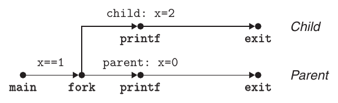

Em um único processador, qualquer **ordenação topológica** dos vértices é uma ordem possível de execução. Um jeito simples de ver isso: coloque os vértices em uma linha, da esquerda para a direita, em alguma ordem, e desenhe as arestas. A ordem é uma ordenação topológica se todas as arestas apontarem para a direita. No exemplo, os dois `printf` podem acontecer em qualquer ordem, porque as duas ordens são ordenações topológicas do grafo.

O grafo ajuda bastante com `fork` aninhados. O programa abaixo chama `fork` duas vezes, e o grafo mostra que ele roda **quatro processos**, cada um chamando `printf`, em qualquer ordem:

```c
int main()
{
    Fork();
    Fork();
    printf("hello\n");
    exit(0);
}
```

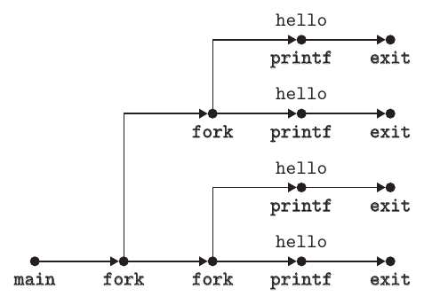

### Colhendo processos filhos

Quando um processo termina, o kernel não o remove do sistema na hora. Ele fica em estado terminado até ser **colhido** (*reaped*) pelo pai. Quando o pai colhe o filho, o kernel passa o status de saída do filho para o pai e então descarta o processo, que deixa de existir. **Um processo terminado que ainda não foi colhido é chamado de zumbi** (*zombie*), porque, assim como um morto-vivo, ele já terminou, mas o kernel ainda guarda parte do estado dele.

Quando um pai termina, o kernel faz o processo **`init`** adotar os filhos órfãos. O `init` tem PID 1, é criado pelo kernel quando o sistema inicia, nunca termina e é o ancestral de todos os processos. Se um pai termina sem colher os seus zumbis, o `init` colhe por ele. Mas programas que rodam por muito tempo, como shells e servidores, devem sempre colher os seus zumbis, porque **mesmo sem rodar, eles ainda ocupam memória do sistema**.

Um processo espera os filhos terminarem ou pararem com a função `waitpid`:

```c
#include <sys/types.h>
#include <sys/wait.h>

pid_t waitpid(pid_t pid, int *statusp, int options);
```

O `waitpid` é complicado. Por padrão (`options = 0`), ele **suspende o processo que o chamou até algum filho do seu conjunto de espera terminar**. Se algum já tiver terminado na hora da chamada, ele retorna na hora. Nos dois casos, devolve o PID do filho que terminou, que nesse momento já foi colhido e teve todos os seus rastros removidos do sistema.

#### O conjunto de espera

Quem está no conjunto de espera depende do argumento `pid`:

- Se `pid > 0`, o conjunto é só o filho com aquele PID.
- Se `pid = -1`, o conjunto são todos os filhos do processo.

#### Mudando o comportamento padrão

O comportamento padrão pode ser mudado combinando as constantes `WNOHANG`, `WUNTRACED` e `WCONTINUED` no argumento `options`:

- **`WNOHANG`:** retorna na hora (com valor 0) se nenhum filho do conjunto tiver terminado ainda. É útil para continuar fazendo outras coisas enquanto espera.
- **`WUNTRACED`:** suspende o processo até algum filho do conjunto terminar **ou parar**, e devolve o PID dele. Útil para checar os dois casos.
- **`WCONTINUED`:** suspende o processo até algum filho do conjunto terminar ou até algum filho parado voltar a rodar ao receber um `SIGCONT`.

As opções podem ser combinadas com OU. Por exemplo, `WNOHANG | WUNTRACED` retorna na hora com 0 se nenhum filho tiver parado ou terminado, ou com o PID de algum que tenha.

Essas constantes são definidas nos headers do sistema (`WNOHANG` e `WUNTRACED`, por exemplo, vêm de `wait.h`), então é preciso incluir `<sys/wait.h>` para usá-las. Para checar códigos de erro como `ECHILD` e `EINTR`, é preciso incluir `errno.h`. O livro simplifica isso com um único header, `csapp.h`, que inclui tudo o que os exemplos usam.

#### Verificando o status de saída

Se `statusp` não for `NULL`, o `waitpid` guarda em `status` (o valor apontado por `statusp`) informações sobre o filho que causou o retorno. O `wait.h` define macros para interpretar esse valor:

- **`WIFEXITED(status)`:** verdadeiro se o filho terminou normalmente, com `exit` ou `return`.
- **`WEXITSTATUS(status)`:** o status de saída do filho, válido só se `WIFEXITED` for verdadeiro.
- **`WIFSIGNALED(status)`:** verdadeiro se o filho terminou por causa de um sinal que não foi capturado.
- **`WTERMSIG(status)`:** o número do sinal que terminou o filho, válido só se `WIFSIGNALED` for verdadeiro.
- **`WIFSTOPPED(status)`:** verdadeiro se o filho que causou o retorno está parado.
- **`WSTOPSIG(status)`:** o número do sinal que parou o filho, válido só se `WIFSTOPPED` for verdadeiro.
- **`WIFCONTINUED(status)`:** verdadeiro se o filho voltou a rodar ao receber um `SIGCONT`.

#### Condições de erro

Se o processo não tiver filhos, o `waitpid` retorna −1 e coloca `ECHILD` em `errno`. Se for interrompido por um sinal, retorna −1 e coloca `EINTR` em `errno`.

#### A função `wait`

A função `wait` é uma versão mais simples do `waitpid`. Chamar `wait(&status)` é o mesmo que chamar `waitpid(-1, &status, 0)`:

```c
#include <sys/types.h>
#include <sys/wait.h>

pid_t wait(int *statusp);
```

#### Exemplos com `waitpid`

O programa abaixo usa o `waitpid` para esperar, sem uma ordem definida, todos os seus `N` filhos terminarem. O pai cria cada filho dentro do `for`, e cada filho termina logo em seguida com `exit(100+i)`, um status de saída diferente para cada um (só os filhos executam esse `exit`, porque para eles o `Fork` devolve 0):

```c
#include "csapp.h"
#define N 2

int main()
{
    int status, i;
    pid_t pid;

    /* Parent creates N children */
    for (i = 0; i < N; i++)
        if ((pid = Fork()) == 0) /* Child */
            exit(100+i);

    /* Parent reaps N children in no particular order */
    while ((pid = waitpid(-1, &status, 0)) > 0) {
        if (WIFEXITED(status))
            printf("child %d terminated normally with exit status=%d\n",
                   pid, WEXITSTATUS(status));
        else
            printf("child %d terminated abnormally\n", pid);
    }

    /* The only normal termination is if there are no more children */
    if (errno != ECHILD)
        unix_error("waitpid error");

    exit(0);
}
```

O pai usa o `waitpid` como condição do `while`. Como o primeiro argumento é −1, cada chamada bloqueia até **algum** filho terminar e devolve o PID dele. O `WIFEXITED` verifica se o filho terminou normalmente e, se sim, imprime o status de saída. Quando todos os filhos já foram colhidos, a próxima chamada retorna −1 e coloca `ECHILD` em `errno`, e o `if (errno != ECHILD)` confere que foi isso que aconteceu:

```
linux> ./waitpid1
child 22966 terminated normally with exit status=100
child 22967 terminated normally with exit status=101
```

Os filhos são colhidos **sem ordem definida**. Em outro sistema, ou em outra execução, eles poderiam ser colhidos na ordem inversa. Esse é um exemplo do **comportamento não determinístico** que torna a concorrência tão difícil: os dois resultados são igualmente corretos, e o programador nunca pode supor que um deles vai sempre acontecer, por mais improvável que o outro pareça.

Uma mudança simples elimina esse não determinismo: o pai guarda os PIDs dos filhos na ordem em que os cria e espera cada um nessa mesma ordem, passando o PID certo como primeiro argumento do `waitpid`:

```c
#include "csapp.h"
#define N 2

int main()
{
    int status, i;
    pid_t pid[N], retpid;

    /* Parent creates N children */
    for (i = 0; i < N; i++)
        if ((pid[i] = Fork()) == 0)          /* Child */
            exit(100+i);

    /* Parent reaps N children in order */
    i = 0;
    while ((retpid = waitpid(pid[i++], &status, 0)) > 0) {
        if (WIFEXITED(status))
            printf("child %d terminated normally with exit status=%d\n",
                   retpid, WEXITSTATUS(status));
        else
            printf("child %d terminated abnormally\n", retpid);
    }

    /* The only normal termination is if there are no more children */
    if (errno != ECHILD)
        unix_error("waitpid error");

    exit(0);
}
```

### Colocando processos para dormir

A função `sleep` suspende o processo por um certo tempo:

```c
#include <unistd.h>

unsigned int sleep(unsigned int secs);
```

Ela devolve 0 se o tempo pedido passou, ou o número de segundos que ainda faltavam. O segundo caso acontece quando o `sleep` é interrompido antes da hora por um sinal.

Outra função útil é a `pause`, que coloca o processo para dormir até ele receber um sinal. Ela sempre devolve −1:

```c
#include <unistd.h>

int pause(void);
```

### Carregando e rodando programas

A função `execve` carrega e roda um novo programa **no contexto do processo atual**:

```c
#include <unistd.h>

int execve(const char *filename, const char *argv[],
           const char *envp[]);
```

Ela carrega e roda o executable object file `filename`, com a lista de argumentos `argv` e a lista de variáveis de ambiente `envp`. O `execve` só retorna para quem o chamou se der erro, como quando não encontra o `filename`. Então, ao contrário do `fork`, que é chamado uma vez e retorna duas, **o `execve` é chamado uma vez e nunca retorna**.

O `argv` aponta para um vetor de ponteiros terminado em `NULL`, em que cada ponteiro aponta para uma string de argumento. Por convenção, `argv[0]` é o nome do executável. O `envp` tem a mesma estrutura, e cada string é um par `nome=valor`:

![Organização da lista de argumentos: argv aponta para o vetor argv[], cujos elementos apontam para as strings "ls", "-lt" e "/user/include", terminando em NULL (CS:APP, Figura 8.20)](12.png)

![Organização da lista de variáveis de ambiente: envp aponta para o vetor envp[], cujos elementos apontam para strings como "PWD=/usr/droh", "PRINTER=iron" e "USER=droh", terminando em NULL (CS:APP, Figura 8.21)](13.png)

Depois de carregar o `filename`, o `execve` chama o código de inicialização visto no post sobre linking, que prepara a pilha e passa o controle para a `main` do novo programa, com o protótipo:

```c
int main(int argc, char **argv, char **envp);
```

ou, de forma equivalente:

```c
int main(int argc, char *argv[], char *envp[]);
```

Quando a `main` começa, a pilha do usuário tem esta organização:

![Organização típica da pilha do usuário quando um programa começa: no fundo, as strings das variáveis de ambiente e dos argumentos; acima, o vetor envp[] (apontado pela variável global environ e por envp em %rdx), o vetor argv[] (apontado por argv em %rsi), argc em %rdi, o stack frame de libc_start_main e, no topo, o futuro stack frame da main (CS:APP, Figura 8.22)](14.png)

Do fundo da pilha (endereço mais alto) para o topo (endereço mais baixo): primeiro vêm as strings dos argumentos e das variáveis de ambiente. Acima delas fica o vetor de ponteiros para as variáveis de ambiente, terminado em `NULL`, e a variável global `environ` aponta para o primeiro deles, `envp[0]`. Depois vem o vetor `argv[]`, também terminado em `NULL`, com cada elemento apontando para uma string de argumento. No topo fica o stack frame da função de inicialização `libc_start_main`.

A `main` recebe três argumentos, cada um em um registrador, seguindo a convenção do x86-64:

- **`argc`** (em `%rdi`): o número de ponteiros não nulos em `argv[]`.
- **`argv`** (em `%rsi`): aponta para o primeiro elemento de `argv[]`.
- **`envp`** (em `%rdx`): aponta para o primeiro elemento de `envp[]`.

O Linux tem algumas funções para manipular as variáveis de ambiente:

```c
#include <stdlib.h>

char *getenv(const char *name);
int setenv(const char *name, const char *newvalue, int overwrite);
void unsetenv(const char *name);
```

- **`getenv`** procura no vetor uma string `name=valor` e devolve um ponteiro para o `valor`, ou `NULL` se não encontrar.
- **`unsetenv`** apaga a string `name=valor`, se ela existir.
- **`setenv`** troca o valor antigo por `newvalue`, mas só se `overwrite` for diferente de zero. Se `name` não existir, ele adiciona `name=newvalue` ao vetor.

### Usando `fork` e `execve` para rodar programas

Programas como shells Unix e servidores web usam muito o `fork` e o `execve`. Um **shell** é um programa interativo que roda outros programas em nome do usuário. O primeiro foi o `sh`, seguido por variações como `csh`, `tcsh`, `ksh` e `bash`. O shell repete uma sequência de passos de **leitura** e **avaliação**: a leitura pega uma linha de comando do usuário, e a avaliação interpreta essa linha e roda os programas pedidos.

> **Programa x processo.** Um **programa** é um conjunto de código e dados, que pode existir como object file no disco ou como segmentos em um espaço de endereçamento. Um **processo** é uma instância específica de um programa em execução, e um programa sempre roda no contexto de algum processo. Essa diferença é essencial para entender o `fork` e o `execve`: o `fork` roda o **mesmo programa** em um novo processo filho, que é uma cópia do pai. O `execve` carrega e roda um **novo programa** no contexto do processo atual. Ele sobrescreve o espaço de endereçamento do processo, mas **não cria um novo processo**: o programa novo continua com o mesmo PID e herda todos os descritores de arquivo que estavam abertos na hora da chamada.

A rotina `main` de um shell simples imprime um prompt, espera o usuário digitar uma linha de comando no `stdin` e então avalia essa linha:

```c
#include "csapp.h"
#define MAXARGS   128

/* Function prototypes */
void eval(char *cmdline);
int parseline(char *buf, char **argv);
int builtin_command(char **argv);

int main()
{
    char cmdline[MAXLINE]; /* Command line */

    while (1) {
        /* Read */
        printf("> ");
        Fgets(cmdline, MAXLINE, stdin);
        if (feof(stdin))
            exit(0);

        /* Evaluate */
        eval(cmdline);
    }
}
```

A função `eval` começa chamando a `parseline`, que separa os argumentos da linha de comando (divididos por espaços) e monta o vetor `argv` que depois vai ser passado ao `execve`. O primeiro argumento é o nome de um **comando embutido** do shell, que é interpretado na hora, ou de um executável, que vai ser carregado e rodado em um novo processo filho. Se o último argumento for `&`, a `parseline` devolve 1, indicando que o programa deve rodar em **segundo plano** (*background*), sem o shell esperar ele terminar. Senão, devolve 0, e o programa roda em **primeiro plano** (*foreground*), com o shell esperando.

Depois disso, a `eval` chama a `builtin_command`, que verifica se o primeiro argumento é um comando embutido. Se for, ela o executa na hora e devolve 1. Senão, devolve 0. Esse shell só tem um comando embutido, o `quit`, que termina o shell (shells de verdade têm vários, como `pwd`, `jobs` e `fg`).

Se a `builtin_command` devolver 0, o shell cria um processo filho e roda nele o programa pedido. Se o usuário pediu para rodar em segundo plano, o shell volta para o começo do loop e espera a próxima linha de comando. Senão, usa o `waitpid` para esperar o programa terminar e só então segue para a próxima iteração:

```c
/* eval - Evaluate a command line */
void eval(char *cmdline)
{
    char *argv[MAXARGS]; /* Argument list execve() */
    char buf[MAXLINE];   /* Holds modified command line */
    int bg;              /* Should the job run in bg or fg? */
    pid_t pid;           /* Process id */

    strcpy(buf, cmdline);
    bg = parseline(buf, argv);
    if (argv[0] == NULL)
        return;   /* Ignore empty lines */

    if (!builtin_command(argv)) {
        if ((pid = Fork()) == 0) {   /* Child runs user job */
            if (execve(argv[0], argv, environ) < 0) {
                printf("%s: Command not found.\n", argv[0]);
                exit(0);
            }
        }

        /* Parent waits for foreground job to terminate */
        if (!bg) {
            int status;
            if (waitpid(pid, &status, 0) < 0)
                unix_error("waitfg: waitpid error");
        }
        else
            printf("%d %s", pid, cmdline);
    }
    return;
}

/* If first arg is a builtin command, run it and return true */
int builtin_command(char **argv)
{
    if (!strcmp(argv[0], "quit")) /* quit command */
        exit(0);
    if (!strcmp(argv[0], "&"))    /* Ignore singleton & */
        return 1;
    return 0;                     /* Not a builtin command */
}
```

```c
/* parseline - Parse the command line and build the argv array */
int parseline(char *buf, char **argv)
{
    char *delim;         /* Points to first space delimiter */
    int argc;            /* Number of args */
    int bg;              /* Background job? */

    buf[strlen(buf)-1] = ' '; /* Replace trailing '\n' with space */
    while (*buf && (*buf == ' ')) /* Ignore leading spaces */
        buf++;

    /* Build the argv list */
    argc = 0;
    while ((delim = strchr(buf, ' '))) {
        argv[argc++] = buf;
        *delim = '\0';
        buf = delim + 1;
        while (*buf && (*buf == ' ')) /* Ignore spaces */
            buf++;
    }
    argv[argc] = NULL;

    if (argc == 0)       /* Ignore blank line */
        return 1;

    /* Should the job run in the background? */
    if ((bg = (*argv[argc-1] == '&')) != 0)
        argv[--argc] = NULL;

    return bg;
}
```

Esse shell tem um defeito: **ele não colhe os filhos que rodam em segundo plano**, que ficam como zumbis. Para corrigir isso é preciso usar sinais, o assunto da próxima seção.

## Sinais

Até aqui, vimos como o hardware e o software cooperam para oferecer o mecanismo básico de exceções, e como o sistema operacional usa exceções para fazer trocas de contexto entre processos. Agora vamos ver uma forma de ECF de mais alto nível, feita em software: o **sinal** do Linux, que permite que processos e o kernel interrompam outros processos.

Um **sinal** é uma pequena mensagem que avisa um processo de que algum tipo de evento aconteceu no sistema. O Linux tem 30 tipos de sinais:

| Número | Nome | Ação padrão | Evento |
|---|---|---|---|
| 1 | `SIGHUP` | Terminar | O terminal foi desligado |
| 2 | `SIGINT` | Terminar | Interrupção pelo teclado (`Ctrl+C`) |
| 3 | `SIGQUIT` | Terminar | Saída pelo teclado |
| 4 | `SIGILL` | Terminar | Instrução ilegal |
| 5 | `SIGTRAP` | Terminar e fazer dump de core | Trap de rastreamento |
| 6 | `SIGABRT` | Terminar e fazer dump de core | Sinal de abort, vindo da função `abort` |
| 7 | `SIGBUS` | Terminar | Erro de barramento |
| 8 | `SIGFPE` | Terminar e fazer dump de core | Exceção de ponto flutuante |
| 9 | `SIGKILL` | Terminar (não pode ser capturado nem ignorado) | Matar o programa |
| 10 | `SIGUSR1` | Terminar | Sinal 1 definido pelo usuário |
| 11 | `SIGSEGV` | Terminar e fazer dump de core | Referência inválida à memória (*segfault*) |
| 12 | `SIGUSR2` | Terminar | Sinal 2 definido pelo usuário |
| 13 | `SIGPIPE` | Terminar | Escrita em um pipe sem leitor |
| 14 | `SIGALRM` | Terminar | Sinal de timer da função `alarm` |
| 15 | `SIGTERM` | Terminar | Sinal de término por software |
| 16 | `SIGSTKFLT` | Terminar | Falha de pilha no coprocessador |
| 17 | `SIGCHLD` | Ignorar | Um processo filho parou ou terminou |
| 18 | `SIGCONT` | Ignorar | Continuar o processo, se estiver parado |
| 19 | `SIGSTOP` | Parar até o próximo `SIGCONT` (não pode ser capturado nem ignorado) | Sinal de parada que não vem do terminal |
| 20 | `SIGTSTP` | Parar até o próximo `SIGCONT` | Sinal de parada vindo do terminal (`Ctrl+Z`) |
| 21 | `SIGTTIN` | Parar até o próximo `SIGCONT` | Processo em segundo plano leu do terminal |
| 22 | `SIGTTOU` | Parar até o próximo `SIGCONT` | Processo em segundo plano escreveu no terminal |
| 23 | `SIGURG` | Ignorar | Condição urgente em um socket |
| 24 | `SIGXCPU` | Terminar | Limite de tempo de CPU excedido |
| 25 | `SIGXFSZ` | Terminar | Limite de tamanho de arquivo excedido |
| 26 | `SIGVTALRM` | Terminar | Timer virtual expirou |
| 27 | `SIGPROF` | Terminar | Timer de profiling expirou |
| 28 | `SIGWINCH` | Ignorar | O tamanho da janela mudou |
| 29 | `SIGIO` | Terminar | I/O possível em um descritor |
| 30 | `SIGPWR` | Terminar | Falha de energia |

*"Fazer dump de core" é um termo histórico, de quando a memória principal era feita de uma tecnologia chamada core memory, e significa gravar no disco uma imagem dos segmentos de código e de dados do programa.*

Cada tipo de sinal corresponde a algum evento do sistema. As exceções de hardware de baixo nível são tratadas pelos exception handlers do kernel e normalmente não seriam visíveis para os processos do usuário. **Os sinais são o mecanismo que expõe essas exceções para os processos.** Por exemplo:

- Se um processo tenta dividir por zero, o kernel envia a ele um `SIGFPE`.
- Se executa uma instrução ilegal, recebe um `SIGILL`.
- Se faz um acesso inválido à memória, recebe um `SIGSEGV`.

Outros sinais correspondem a eventos de software de mais alto nível, no kernel ou em outros processos. Digitar `Ctrl+C` com um processo rodando em primeiro plano faz o kernel enviar um `SIGINT` para cada processo do grupo de primeiro plano. Um processo pode forçar o término de outro enviando um `SIGKILL`. E quando um filho termina ou para, o kernel envia um `SIGCHLD` para o pai.

### Terminologia de sinais

A transferência de um sinal para o processo de destino acontece em duas etapas:

- **Envio.** O kernel **envia** (ou **entrega**) um sinal a um processo atualizando algum estado no contexto desse processo. Isso acontece por um de dois motivos: o kernel detectou um evento do sistema, como uma divisão por zero ou o término de um filho, ou um processo chamou a função `kill` para pedir explicitamente ao kernel que envie o sinal. Um processo pode enviar um sinal para si mesmo.
- **Recebimento.** O processo de destino **recebe** o sinal quando o kernel o obriga a reagir à entrega. O processo pode ignorar o sinal, terminar ou **capturá-lo**, executando uma função do usuário chamada **signal handler**.

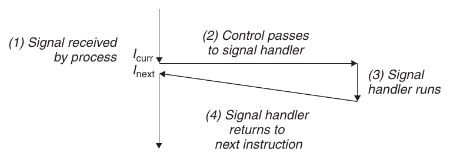

Um sinal que foi enviado, mas ainda não foi recebido, é um **sinal pendente**. **Em cada momento, pode existir no máximo um sinal pendente de cada tipo.** Se um processo já tem um sinal pendente do tipo *k*, os próximos sinais do tipo *k* enviados a ele **não entram em fila: são simplesmente descartados**.

Um processo também pode **bloquear** o recebimento de certos sinais. Um sinal bloqueado ainda pode ser entregue, mas o sinal pendente resultante só vai ser recebido quando o processo desbloquear aquele tipo. Um sinal pendente é recebido no máximo uma vez.

Para cada processo, o kernel guarda os sinais pendentes no vetor de bits **`pending`** e os bloqueados no vetor de bits **`blocked`** (também chamado de *signal mask*). O kernel liga o bit *k* de `pending` quando um sinal do tipo *k* é entregue e desliga quando ele é recebido.

### Enviando sinais

Todos os mecanismos que o Unix oferece para enviar sinais se baseiam na ideia de **grupo de processos**.

#### Grupos de processos

Todo processo pertence a exatamente um grupo de processos, identificado por um inteiro positivo, o **ID do grupo**. A função `getpgrp` devolve o ID do grupo do processo atual:

```c
#include <unistd.h>

pid_t getpgrp(void);
```

Por padrão, um filho pertence ao mesmo grupo do pai. Um processo pode mudar o grupo dele mesmo ou de outro processo com a função `setpgid`:

```c
#include <unistd.h>

int setpgid(pid_t pid, pid_t pgid);
```

Ela muda o grupo do processo `pid` para `pgid`. Se `pid` for zero, usa o PID do processo atual. Se `pgid` for zero, usa o PID do processo `pid` como ID do grupo. Por exemplo, se o processo 15213 chamar `setpgid(0, 0)`, ele cria um novo grupo com ID 15213 e entra nele.

#### Com o programa `/bin/kill`

O programa `/bin/kill` envia qualquer sinal para outro processo. O comando abaixo envia o sinal 9 (`SIGKILL`) para o processo 15213:

```
linux> /bin/kill -9 15213
```

Um PID negativo faz o sinal ser enviado para todos os processos do grupo. Este comando envia um `SIGKILL` para todos os processos do grupo 15213:

```
linux> /bin/kill -9 -15213
```

O caminho completo `/bin/kill` é usado porque alguns shells têm o seu próprio comando `kill` embutido.

#### Pelo teclado

Os shells usam a ideia de **job** para representar os processos criados ao avaliar uma única linha de comando. Em cada momento, existe no máximo um job em **primeiro plano** e zero ou mais em **segundo plano**. Por exemplo, `ls | sort` cria um job em primeiro plano com dois processos ligados por um pipe: um rodando o `ls` e outro o `sort`.

O shell cria um grupo de processos separado para cada job, normalmente com o ID tirado de um dos processos pais do job. Na figura, o processo pai do job em primeiro plano tem PID 20 e ID de grupo 20, e os dois filhos que ele criou também estão no grupo 20:

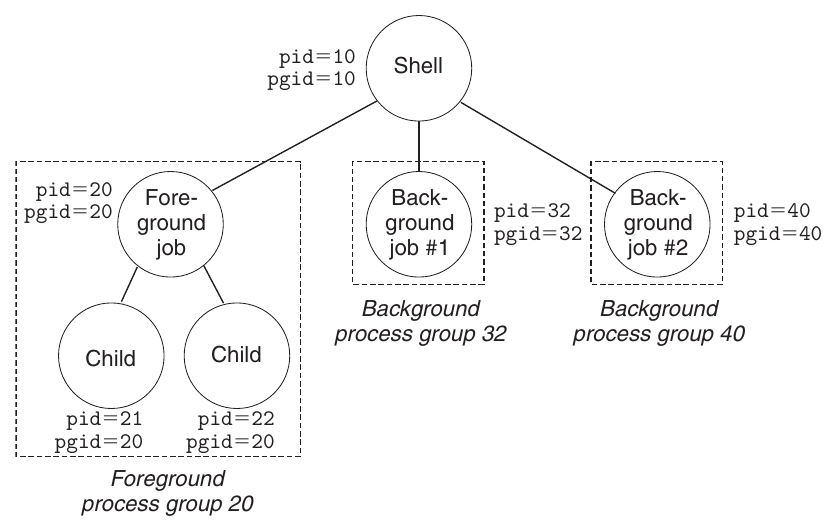

Digitar **`Ctrl+C`** faz o kernel enviar um `SIGINT` para todos os processos do grupo em primeiro plano, o que, por padrão, termina o job. Digitar **`Ctrl+Z`** envia um `SIGTSTP`, que, por padrão, para (suspende) o job.

#### Com a função `kill`

Um processo envia sinais para outros (ou para si mesmo) com a função `kill`:

```c
#include <sys/types.h>
#include <signal.h>

int kill(pid_t pid, int sig);
```

- Se `pid > 0`, envia o sinal `sig` para o processo `pid`.
- Se `pid = 0`, envia para todos os processos do grupo do processo que chamou, incluindo ele mesmo.
- Se `pid < 0`, envia para todos os processos do grupo |`pid`|.

No exemplo abaixo, o pai usa o `kill` para enviar um `SIGKILL` ao filho:

```c
#include "csapp.h"

int main()
{
    pid_t pid;

    /* Child sleeps until SIGKILL signal received, then dies */
    if ((pid = Fork()) == 0) {
        Pause(); /* Wait for a signal to arrive */
        printf("control should never reach here!\n");
        exit(0);
    }

    /* Parent sends a SIGKILL signal to a child */
    Kill(pid, SIGKILL);
    exit(0);
}
```

#### Com a função `alarm`

Um processo pode enviar sinais `SIGALRM` para si mesmo com a função `alarm`:

```c
#include <unistd.h>

unsigned int alarm(unsigned int secs);
```

Ela faz o kernel enviar um `SIGALRM` ao processo daqui a `secs` segundos. Se `secs` for 0, nenhum alarme novo é agendado. Em todo caso, a chamada cancela qualquer alarme pendente e devolve quantos segundos faltavam para ele, ou 0 se não havia nenhum.

### Recebendo sinais

Quando o kernel passa um processo *p* do modo kernel para o modo usuário (por exemplo, ao voltar de uma system call ou ao terminar uma troca de contexto), ele verifica o conjunto de **sinais pendentes não bloqueados** de *p* (`pending & ~blocked`). Se o conjunto estiver vazio, que é o caso mais comum, o kernel passa o controle para a próxima instrução, \(I_{next}\). Se não estiver, o kernel escolhe algum sinal *k* do conjunto (normalmente o menor) e obriga *p* a recebê-lo. O recebimento dispara alguma ação e, quando ela termina, o controle volta para \(I_{next}\).

Cada tipo de sinal tem uma **ação padrão**, que é uma destas:

- O processo termina.
- O processo termina e faz dump de core.
- O processo para até ser retomado por um `SIGCONT`.
- O processo ignora o sinal.

A ação padrão do `SIGKILL`, por exemplo, é terminar o processo, e a do `SIGCHLD` é ignorar. Um processo pode mudar a ação padrão de um sinal com a função `signal`. As únicas exceções são `SIGSTOP` e `SIGKILL`, cujas ações não podem ser mudadas.

```c
#include <signal.h>
typedef void (*sighandler_t)(int);

sighandler_t signal(int signum, sighandler_t handler);
```

A função `signal` muda a ação do sinal `signum` de uma de três formas:

- Se `handler` for `SIG_IGN`, os sinais do tipo `signum` são ignorados.
- Se `handler` for `SIG_DFL`, a ação volta a ser a padrão.
- Senão, `handler` é o endereço de uma função do usuário, o **signal handler**, que vai ser chamada sempre que o processo receber um sinal do tipo `signum`.

Passar o endereço de um handler para o `signal` é **instalar** o handler. A chamada do handler é **capturar** o sinal, e a execução dele é **tratar** o sinal. O handler recebe como argumento o número do sinal, o que permite usar a mesma função para vários tipos. Quando o handler executa o `return`, o controle (normalmente) volta para a instrução em que o processo foi interrompido. O "normalmente" é porque, em alguns sistemas, system calls interrompidas retornam na hora com erro.

O programa abaixo captura o `SIGINT` enviado pelo `Ctrl+C`. Em vez de terminar na hora, que é a ação padrão, ele imprime uma mensagem e só então termina:

```c
#include "csapp.h"

void sigint_handler(int sig) /* SIGINT handler */
{
    printf("Caught SIGINT!\n");
    exit(0);
}

int main()
{
    /* Install the SIGINT handler */
    if (signal(SIGINT, sigint_handler) == SIG_ERR)
        unix_error("signal error");

    pause(); /* Wait for the receipt of a signal */

    return 0;
}
```

Signal handlers também podem ser interrompidos por outros handlers. Na figura, o programa principal captura o sinal *s*, que o interrompe e passa o controle para o handler *S*. Enquanto *S* roda, o programa captura um sinal *t* ≠ *s*, que interrompe *S* e passa o controle para o handler *T*. Quando *T* retorna, *S* continua de onde parou e, quando *S* retorna, o programa principal continua:

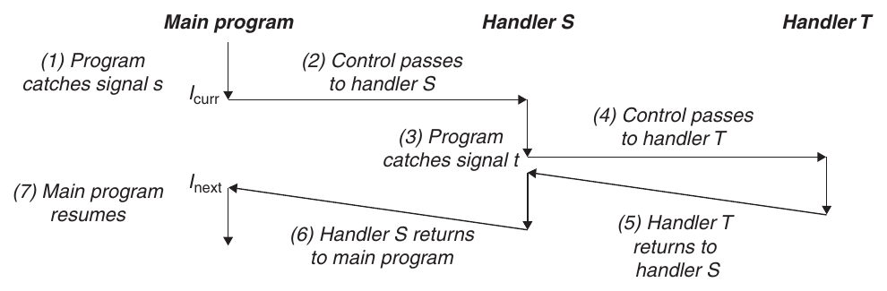

### Bloqueando e desbloqueando sinais

O Linux tem dois mecanismos para bloquear sinais:

- **Implícito.** Por padrão, o kernel bloqueia os sinais pendentes do mesmo tipo do que está sendo tratado por um handler. Na figura anterior, se outro sinal *s* chegar enquanto o handler *S* roda, ele fica pendente e só é recebido depois que *S* retornar.
- **Explícito.** O programa pode bloquear e desbloquear sinais com a função `sigprocmask` e suas auxiliares.

```c
#include <signal.h>

int sigprocmask(int how, const sigset_t *set, sigset_t *oldset);
int sigemptyset(sigset_t *set);
int sigfillset(sigset_t *set);
int sigaddset(sigset_t *set, int signum);
int sigdelset(sigset_t *set, int signum);
int sigismember(const sigset_t *set, int signum);
```

O `sigprocmask` muda o conjunto de sinais bloqueados (o vetor `blocked`). O comportamento depende de `how`:

- **`SIG_BLOCK`:** acrescenta os sinais de `set` aos bloqueados.
- **`SIG_UNBLOCK`:** tira os sinais de `set` dos bloqueados.
- **`SIG_SETMASK`:** os bloqueados passam a ser exatamente `set`.

Se `oldset` não for `NULL`, o conjunto anterior é guardado nele. As outras funções manipulam conjuntos de sinais: `sigemptyset` esvazia o conjunto, `sigfillset` coloca todos os sinais nele, `sigaddset` acrescenta um, `sigdelset` tira um, e `sigismember` diz se um sinal está no conjunto.

O trecho abaixo bloqueia o `SIGINT` temporariamente:

```c
sigset_t mask, prev_mask;

Sigemptyset(&mask);
Sigaddset(&mask, SIGINT);

/* Block SIGINT and save previous blocked set */
Sigprocmask(SIG_BLOCK, &mask, &prev_mask);
// Code region that will not be interrupted by SIGINT
/* Restore previous blocked set, unblocking SIGINT */
Sigprocmask(SIG_SETMASK, &prev_mask, NULL);
```

### Escrevendo signal handlers

Tratar sinais é uma das partes mais traiçoeiras da programação de sistemas no Linux, por três motivos: os handlers rodam **concorrentemente** com o programa principal e compartilham as mesmas variáveis globais, então podem interferir nele e em outros handlers; as regras de como e quando os sinais são recebidos são pouco intuitivas; e sistemas diferentes podem tratar sinais de formas diferentes.

#### Tratamento seguro

Se um handler e o programa principal acessam a mesma estrutura de dados global ao mesmo tempo, o resultado pode ser imprevisível e muitas vezes fatal. Com esse tipo de erro, o programa funciona quase sempre, mas quando falha, falha de forma imprevisível e difícil de repetir, o que torna a depuração terrível. As regras abaixo são conservadoras, mas evitam esses problemas:

- **G0. Mantenha os handlers o mais simples possível.** Por exemplo, o handler pode só ligar uma flag global e retornar, deixando todo o processamento para o programa principal, que verifica (e desliga) a flag de vez em quando.
- **G1. Chame só funções async-signal-safe.** Uma função **async-signal-safe** (ou só *segura*) pode ser chamada de dentro de um handler, porque é **reentrante** (por exemplo, só acessa variáveis locais) ou porque não pode ser interrompida por um handler. O Linux garante uma lista dessas funções, como `_exit`, `write`, `kill`, `fork`, `execve`, `waitpid`, `sleep` e `sigprocmask`. Funções populares como **`printf`, `sprintf`, `malloc` e `exit` não estão na lista**. A única forma segura de imprimir de dentro de um handler é com a função `write`, e por isso o livro criou o pacote **Sio** (*Safe I/O*):

```c
#include "csapp.h"

ssize_t sio_putl(long v);
ssize_t sio_puts(char s[]);
void sio_error(char s[]);
```

`sio_putl` e `sio_puts` imprimem um `long` e uma string, e `sio_error` imprime uma mensagem de erro e termina. A implementação usa só `write` e `_exit`, a versão segura do `exit`:

```c
ssize_t sio_puts(char s[]) /* Put string */
{
    return write(STDOUT_FILENO, s, sio_strlen(s));
}

ssize_t sio_putl(long v) /* Put long */
{
    char s[128];

    sio_ltoa(v, s, 10); /* Based on K&R itoa() */
    return sio_puts(s);
}

void sio_error(char s[]) /* Put error message and exit */
{
    sio_puts(s);
    _exit(1);
}
```

Com isso, o handler de `SIGINT` do exemplo anterior fica seguro assim:

```c
#include "csapp.h"

void sigint_handler(int sig) /* Safe SIGINT handler */
{
    Sio_puts("Caught SIGINT!\n"); /* Safe output */
    _exit(0);                     /* Safe exit */
}
```

- **G2. Salve e restaure o `errno`.** Muitas funções seguras mudam o `errno` quando dão erro, e chamá-las dentro de um handler pode atrapalhar outras partes do programa que dependem dele. A solução é guardar o `errno` em uma variável local quando o handler começa e restaurar antes de ele retornar. Isso só é necessário se o handler retorna, e não se ele termina o processo com `_exit`.
- **G3. Proteja o acesso a estruturas de dados globais compartilhadas bloqueando todos os sinais.** Acessar uma estrutura de dados normalmente exige uma sequência de instruções. Se essa sequência for interrompida por um handler que mexe na mesma estrutura, ele pode encontrá-la em um estado inconsistente. Bloquear os sinais enquanto acessa a estrutura garante que nenhum handler vai interromper no meio.
- **G4. Declare as variáveis globais com `volatile`.** Se o handler atualiza uma variável global `g` e a `main` só lê, um compilador otimizador pode achar que `g` nunca muda na `main` e guardar uma cópia dela em um registrador. Aí a `main` nunca veria as mudanças feitas pelo handler. Declarar `volatile int g;` obriga o compilador a ler `g` da memória sempre que ela for usada.
- **G5. Declare as flags com `sig_atomic_t`.** Para flags que o handler escreve e o programa principal lê e limpa, o C oferece o tipo `sig_atomic_t`, cujas leituras e escritas são **atômicas** (não podem ser interrompidas), porque são feitas com uma única instrução. Assim dá para ler e escrever nelas sem bloquear sinais: `volatile sig_atomic_t flag;`. A garantia vale só para leituras e escritas simples, e não para operações como `flag++` ou `flag = flag + 10`, que podem exigir várias instruções.

Essas regras nem sempre são estritamente necessárias. Se dá para provar que um handler nunca muda o `errno`, não é preciso salvá-lo, e se dá para provar que nenhum `printf` pode ser interrompido por um handler, chamar `printf` no handler é seguro. Mas provar isso em geral é muito difícil, então o mais sensato é seguir as regras.

#### Tratamento correto

Um dos aspectos menos intuitivos dos sinais é que **os sinais pendentes não entram em fila**. Como o vetor `pending` tem exatamente um bit para cada tipo, só pode existir um sinal pendente de cada tipo. Se dois sinais do tipo *k* chegam enquanto *k* está bloqueado (porque o handler de *k* está rodando, por exemplo), o segundo é simplesmente descartado. **A existência de um sinal pendente só indica que pelo menos um sinal chegou.**

Para ver como isso afeta a correção de um programa, imagine uma aplicação parecida com um shell ou um servidor web: o pai cria alguns filhos, que rodam por um tempo e terminam. O pai precisa colhê-los para não deixar zumbis, mas quer continuar livre para fazer outras coisas. Então ele decide colher os filhos em um handler de `SIGCHLD`, já que o kernel envia esse sinal ao pai sempre que um filho termina ou para.

A primeira tentativa instala o handler e cria três filhos. Enquanto isso, o pai espera uma linha do terminal e a processa (o processamento é representado por um loop infinito). Cada vez que recebe um `SIGCHLD`, o handler colhe um filho, faz um trabalho extra de limpeza (representado pelo `Sleep`) e retorna:

```c
/* WARNING: This code is buggy! */

void handler1(int sig)
{
    int olderrno = errno;

    if ((waitpid(-1, NULL, 0)) < 0)
        sio_error("waitpid error");
    Sio_puts("Handler reaped child\n");
    Sleep(1);
    errno = olderrno;
}

int main()
{
    int i, n;
    char buf[MAXBUF];

    if (signal(SIGCHLD, handler1) == SIG_ERR)
        unix_error("signal error");

    /* Parent creates children */
    for (i = 0; i < 3; i++) {
        if (Fork() == 0) {
            printf("Hello from child %d\n", (int)getpid());
            exit(0);
        }
    }

    /* Parent waits for terminal input and then processes it */
    if ((n = read(STDIN_FILENO, buf, sizeof(buf))) < 0)
        unix_error("read");

    printf("Parent processing input\n");
    while (1)
        ;

    exit(0);
}
```

Parece simples, mas a saída mostra um problema:

```
linux> ./signal1
Hello from child 14073
Hello from child 14074
Hello from child 14075
Handler reaped child
Handler reaped child
CR
Parent processing input
```

Três `SIGCHLD` foram enviados, mas só dois foram recebidos, e o pai só colheu dois filhos. Suspendendo o pai com `Ctrl+Z` e rodando `ps`, dá para ver que o filho 14075 virou zumbi (`<defunct>`):

```
Ctrl+Z
Suspended
linux> ps t
  PID TTY          STAT   TIME COMMAND
14072 pts/3        T      0:02 ./signal1
14075 pts/3        Z      0:00 [signal1] <defunct>
14076 pts/3        R+     0:00 ps t
```

O que aconteceu:

1. O primeiro sinal é recebido e capturado pelo pai.
2. Enquanto o handler ainda trata o primeiro, o segundo sinal é entregue e fica pendente. Ele não é recebido porque o handler de `SIGCHLD` bloqueia outros `SIGCHLD`.
3. Ainda durante o primeiro handler, chega o terceiro sinal. Como já existe um `SIGCHLD` pendente, **o terceiro é descartado**.
4. Quando o handler retorna, o kernel vê o `SIGCHLD` pendente e faz o pai recebê-lo, rodando o handler pela segunda vez.
5. Depois disso, não sobra nenhum `SIGCHLD` pendente, e nunca vai sobrar, porque o terceiro se perdeu.

A lição principal: **sinais não servem para contar quantas vezes um evento aconteceu em outros processos**. A correção é lembrar que um sinal pendente só significa que *pelo menos um* sinal chegou desde a última vez. Então o handler precisa colher **o máximo de zumbis possível** cada vez que roda:

```c
void handler2(int sig)
{
    int olderrno = errno;

    while (waitpid(-1, NULL, 0) > 0) {
        Sio_puts("Handler reaped child\n");
    }
    if (errno != ECHILD)
        Sio_error("waitpid error");
    Sleep(1);
    errno = olderrno;
}
```

Agora todos os filhos são colhidos:

```
linux> ./signal2
Hello from child 15237
Hello from child 15238
Hello from child 15239
Handler reaped child
Handler reaped child
Handler reaped child
CR
Parent processing input
```

#### Tratamento portável

Outro problema é que sistemas Unix diferentes tratam sinais de formas diferentes:

- **A semântica da função `signal` varia.** Alguns sistemas Unix antigos voltam a ação do sinal *k* para a padrão depois que *k* é capturado. Nesses sistemas, o handler precisa se reinstalar chamando `signal` toda vez que roda.
- **System calls podem ser interrompidas.** Chamadas como `read`, `wait` e `accept`, que podem bloquear o processo por muito tempo, são chamadas de **system calls lentas**. Em versões antigas do Unix, quando um handler captura um sinal durante uma delas, a system call não continua depois que o handler retorna: ela volta na hora com erro e `errno` igual a `EINTR`, e o programador precisa reiniciá-la manualmente.

Para resolver isso, o padrão Posix define a função `sigaction`, que permite dizer exatamente qual semântica se quer ao instalar um handler:

```c
#include <signal.h>

int sigaction(int signum, struct sigaction *act,
              struct sigaction *oldact);
```

Como o `sigaction` exige preencher uma estrutura complicada, o livro usa um wrapper chamado `Signal`, que é chamado do mesmo jeito que o `signal`:

```c
handler_t *Signal(int signum, handler_t *handler)
{
    struct sigaction action, old_action;

    action.sa_handler = handler;
    sigemptyset(&action.sa_mask); /* Block sigs of type being handled */
    action.sa_flags = SA_RESTART; /* Restart syscalls if possible */

    if (sigaction(signum, &action, &old_action) < 0)
        unix_error("Signal error");
    return (old_action.sa_handler);
}
```

Ele instala o handler com esta semântica:

- Só os sinais do tipo que está sendo tratado ficam bloqueados.
- Como em qualquer implementação, os sinais não entram em fila.
- System calls interrompidas são reiniciadas automaticamente sempre que possível.
- Depois de instalado, o handler continua instalado até `Signal` ser chamado com `SIG_IGN` ou `SIG_DFL`.

### Sincronizando fluxos para evitar bugs de concorrência

Programar fluxos concorrentes que leem e escrevem nas mesmas posições de memória é um desafio antigo da computação. Em geral, o número de intercalações possíveis entre os fluxos cresce exponencialmente com o número de instruções. Algumas intercalações dão a resposta certa e outras não, e o problema é **sincronizar** os fluxos para permitir o maior conjunto possível de intercalações que sempre dê a resposta certa.

O programa abaixo tem a estrutura típica de um shell. O pai acompanha os filhos atuais em uma **lista de jobs** global, com uma entrada por job, e as funções `addjob` e `deletejob` acrescentam e removem entradas. Depois de criar um filho, o pai o acrescenta à lista. Quando colhe um filho no handler de `SIGCHLD`, o remove da lista:

```c
/* WARNING: This code is buggy! */
void handler(int sig)
{
    int olderrno = errno;
    sigset_t mask_all, prev_all;
    pid_t pid;

    Sigfillset(&mask_all);
    while ((pid = waitpid(-1, NULL, 0)) > 0) { /* Reap a zombie child */
        Sigprocmask(SIG_BLOCK, &mask_all, &prev_all);
        deletejob(pid); /* Delete the child from the job list */
        Sigprocmask(SIG_SETMASK, &prev_all, NULL);
    }
    if (errno != ECHILD)
        Sio_error("waitpid error");
    errno = olderrno;
}

int main(int argc, char **argv)
{
    int pid;
    sigset_t mask_all, prev_all;

    Sigfillset(&mask_all);
    Signal(SIGCHLD, handler);
    initjobs(); /* Initialize the job list */

    while (1) {
        if ((pid = Fork()) == 0) { /* Child process */
            Execve("/bin/date", argv, NULL);
        }
        Sigprocmask(SIG_BLOCK, &mask_all, &prev_all); /* Parent process */
        addjob(pid); /* Add the child to the job list */
        Sigprocmask(SIG_SETMASK, &prev_all, NULL);
    }
    exit(0);
}
```

À primeira vista parece correto, mas esta sequência de eventos é possível:

1. O pai executa o `fork`, e o kernel escalona o filho recém-criado em vez do pai.
2. Antes de o pai voltar a rodar, o filho termina e vira zumbi, e o kernel entrega um `SIGCHLD` ao pai.
3. Quando o pai vai voltar a rodar, o kernel vê o `SIGCHLD` pendente e roda o handler no pai.
4. O handler colhe o filho e chama `deletejob`, que não faz nada, porque o pai ainda não acrescentou o filho à lista.
5. Depois do handler, o pai volta do `fork` e acrescenta o filho (que já não existe) à lista com `addjob`.

Ou seja, em algumas intercalações o `deletejob` é chamado antes do `addjob`, e a lista fica com uma entrada de um job que não existe mais e nunca vai ser removida. Em outras intercalações, a ordem é a certa. Esse é um erro clássico de sincronização chamado **condição de corrida** (*race*): aqui, a corrida é entre o `addjob` na `main` e o `deletejob` no handler. Se o `addjob` ganha, o resultado está certo. Se perde, está errado. Esses erros são muito difíceis de depurar, porque é impossível testar todas as intercalações: o código pode rodar um bilhão de vezes sem problema e falhar na próxima.

Uma forma de eliminar a corrida é **bloquear o `SIGCHLD` antes do `fork`** e só desbloquear depois do `addjob`. Assim, o filho só pode ser colhido depois de entrar na lista. Como os filhos herdam o conjunto de sinais bloqueados do pai, é preciso desbloquear o `SIGCHLD` no filho antes do `execve`:

```c
void handler(int sig)
{
    int olderrno = errno;
    sigset_t mask_all, prev_all;
    pid_t pid;

    Sigfillset(&mask_all);
    while ((pid = waitpid(-1, NULL, 0)) > 0) { /* Reap a zombie child */
        Sigprocmask(SIG_BLOCK, &mask_all, &prev_all);
        deletejob(pid); /* Delete the child from the job list */
        Sigprocmask(SIG_SETMASK, &prev_all, NULL);
    }
    if (errno != ECHILD)
        Sio_error("waitpid error");
    errno = olderrno;
}

int main(int argc, char **argv)
{
    int pid;
    sigset_t mask_all, mask_one, prev_one;

    Sigfillset(&mask_all);
    Sigemptyset(&mask_one);
    Sigaddset(&mask_one, SIGCHLD);
    Signal(SIGCHLD, handler);
    initjobs(); /* Initialize the job list */

    while (1) {
        Sigprocmask(SIG_BLOCK, &mask_one, &prev_one); /* Block SIGCHLD */
        if ((pid = Fork()) == 0) { /* Child process */
            Sigprocmask(SIG_SETMASK, &prev_one, NULL); /* Unblock SIGCHLD */
            Execve("/bin/date", argv, NULL);
        }
        Sigprocmask(SIG_BLOCK, &mask_all, NULL); /* Parent process */
        addjob(pid); /* Add the child to the job list */
        Sigprocmask(SIG_SETMASK, &prev_one, NULL); /* Unblock SIGCHLD */
    }
    exit(0);
}
```

### Esperando sinais explicitamente

Às vezes o programa principal precisa esperar um certo handler rodar. Por exemplo, quando um shell cria um job em primeiro plano, ele precisa esperar o job terminar e ser colhido pelo handler de `SIGCHLD` antes de aceitar o próximo comando.

No programa abaixo, o pai instala handlers para `SIGINT` e `SIGCHLD` e entra em um loop infinito. Ele bloqueia o `SIGCHLD` para evitar a corrida vista antes, cria o filho, zera a variável `pid`, desbloqueia o `SIGCHLD` e fica em um **spin loop** esperando `pid` ficar diferente de zero. Quando o filho termina, o handler o colhe e coloca o PID dele na variável global `pid`, o que encerra o loop:

```c
#include "csapp.h"

volatile sig_atomic_t pid;

void sigchld_handler(int s)
{
    int olderrno = errno;
    pid = waitpid(-1, NULL, 0);
    errno = olderrno;
}

void sigint_handler(int s)
{
}

int main(int argc, char **argv)
{
    sigset_t mask, prev;

    Signal(SIGCHLD, sigchld_handler);
    Signal(SIGINT, sigint_handler);
    Sigemptyset(&mask);
    Sigaddset(&mask, SIGCHLD);

    while (1) {
        Sigprocmask(SIG_BLOCK, &mask, &prev); /* Block SIGCHLD */
        if (Fork() == 0) /* Child */
            exit(0);

        /* Parent */
        pid = 0;
        Sigprocmask(SIG_SETMASK, &prev, NULL); /* Unblock SIGCHLD */

        /* Wait for SIGCHLD to be received (wasteful) */
        while (!pid)
            ;

        /* Do some work after receiving SIGCHLD */
        printf(".");
    }
    exit(0);
}
```

O código está correto, mas o spin loop **desperdiça processador**. Colocar um `pause` dentro do loop parece uma solução:

```c
while (!pid)  /* Race! */
    pause();
```

O loop continua necessário porque o `pause` pode ser interrompido por um `SIGINT`. Mas esse código tem uma **condição de corrida** séria: se o `SIGCHLD` chegar depois do teste do `while` e antes do `pause`, o `pause` dorme para sempre. Trocar o `pause` por `sleep` funciona, mas é lento demais: se o sinal chegar entre o `while` e o `sleep`, o programa espera um tempo relativamente longo até testar de novo. Usar um `sleep` mais preciso, como o `nanosleep`, também não resolve, porque não existe um bom intervalo: pequeno demais desperdiça processador, e grande demais deixa o programa lento.

```c
while (!pid) /* Too slow! */
    sleep(1);
```

A solução certa é a função **`sigsuspend`**:

```c
#include <signal.h>

int sigsuspend(const sigset_t *mask);
```

Ela troca temporariamente o conjunto de bloqueados por `mask` e suspende o processo até receber um sinal cuja ação seja rodar um handler ou terminar o processo. Se a ação for terminar, o processo termina sem voltar do `sigsuspend`. Se for rodar um handler, o `sigsuspend` retorna depois do handler e restaura o conjunto de bloqueados que existia antes da chamada. Ela equivale a uma versão **atômica** (que não pode ser interrompida) deste trecho:

```c
sigprocmask(SIG_BLOCK, &mask, &prev);
pause();
sigprocmask(SIG_SETMASK, &prev, NULL);
```

Por ser atômica, o `sigprocmask` e o `pause` acontecem juntos, sem que um sinal possa chegar entre os dois, o que elimina a corrida. Com o `sigsuspend`, o spin loop fica assim:

```c
#include "csapp.h"

volatile sig_atomic_t pid;

void sigchld_handler(int s)
{
    int olderrno = errno;
    pid = Waitpid(-1, NULL, 0);
    errno = olderrno;
}

void sigint_handler(int s)
{
}

int main(int argc, char **argv)
{
    sigset_t mask, prev;

    Signal(SIGCHLD, sigchld_handler);
    Signal(SIGINT, sigint_handler);
    Sigemptyset(&mask);
    Sigaddset(&mask, SIGCHLD);

    while (1) {
        Sigprocmask(SIG_BLOCK, &mask, &prev); /* Block SIGCHLD */
        if (Fork() == 0) /* Child */
            exit(0);

        /* Wait for SIGCHLD to be received */
        pid = 0;
        while (!pid)
            sigsuspend(&prev);

        /* Optionally unblock SIGCHLD */
        Sigprocmask(SIG_SETMASK, &prev, NULL);

        /* Do some work after receiving SIGCHLD */
        printf(".");
    }
    exit(0);
}
```

Antes de cada `sigsuspend`, o `SIGCHLD` está bloqueado. O `sigsuspend` o desbloqueia temporariamente e dorme até o pai capturar um sinal. Antes de retornar, restaura o conjunto original, bloqueando o `SIGCHLD` de novo. Se o pai capturou um `SIGINT`, o teste do loop dá verdadeiro e o `sigsuspend` é chamado de novo. Se capturou um `SIGCHLD`, o loop termina. Nesse ponto o `SIGCHLD` está bloqueado, e dá para desbloqueá-lo se for preciso, o que seria útil em um shell de verdade com jobs em segundo plano para colher. Essa versão não desperdiça processador como o spin loop, não tem a corrida do `pause` e é mais eficiente que o `sleep`.

## Saltos não locais

O C oferece uma forma de ECF no nível do usuário chamada **salto não local** (*nonlocal jump*), que transfere o controle diretamente de uma função para outra que está em execução, **sem passar pela sequência normal de chamada e retorno**. Os saltos não locais são feitos com as funções `setjmp` e `longjmp`:

```c
#include <setjmp.h>

int setjmp(jmp_buf env);
int sigsetjmp(sigjmp_buf env, int savesigs);

void longjmp(jmp_buf env, int retval);
void siglongjmp(sigjmp_buf env, int retval);
```

- **`setjmp`** guarda o **ambiente de chamada** atual no buffer `env`, para ser usado depois pelo `longjmp`, e retorna 0. O ambiente de chamada inclui o program counter, o stack pointer e os registradores de uso geral. Por motivos sutis, o valor de retorno do `setjmp` não deve ser atribuído a uma variável (`rc = setjmp(env);` está errado), mas pode ser usado como teste em um `switch` ou em um `if`.
- **`longjmp`** restaura o ambiente de chamada guardado em `env` e faz o `setjmp` mais recente que preencheu `env` **retornar de novo**, agora com o valor diferente de zero `retval`.

A interação entre os dois confunde no começo: **o `setjmp` é chamado uma vez, mas retorna várias**, uma quando é chamado e guarda o ambiente, e outra para cada `longjmp` correspondente. Já **o `longjmp` é chamado uma vez e nunca retorna**.

Um uso importante dos saltos não locais é **sair na hora de uma chamada de função muito aninhada**, normalmente ao detectar um erro. Em vez de desfazer a pilha de chamadas uma por uma, dá para saltar direto para um tratador de erros comum. No exemplo abaixo, a `main` chama `setjmp` para guardar o ambiente e depois chama `foo`, que chama `bar`. Se `foo` ou `bar` encontram um erro, voltam direto para o `setjmp` com um `longjmp`, e o valor de retorno do `setjmp` diz qual foi o erro, que é tratado em um único lugar:

```c
#include "csapp.h"

jmp_buf buf;

int error1 = 0;
int error2 = 1;

void foo(void), bar(void);

int main()
{
    switch(setjmp(buf)) {
    case 0:
        foo();
        break;
    case 1:
        printf("Detected an error1 condition in foo\n");
        break;
    case 2:
        printf("Detected an error2 condition in foo\n");
        break;
    default:
        printf("Unknown error condition in foo\n");
    }
    exit(0);
}

/* Deeply nested function foo */
void foo(void)
{
    if (error1)
        longjmp(buf, 1);
    bar();
}

void bar(void)
{
    if (error2)
        longjmp(buf, 2);
}
```

Pular todas as chamadas intermediárias pode ter consequências inesperadas. Se alguma função intermediária alocou estruturas de dados para liberar no fim, o código que libera é pulado, e a memória **vaza**.

Outro uso importante é **sair de um signal handler para um ponto específico do código**, em vez de voltar para a instrução que foi interrompida pelo sinal. O programa abaixo usa sinais e saltos não locais para **reiniciar** sempre que o usuário digita `Ctrl+C`. As funções `sigsetjmp` e `siglongjmp` são versões de `setjmp` e `longjmp` que podem ser usadas por signal handlers:

```c
#include "csapp.h"

sigjmp_buf buf;

void handler(int sig)
{
    siglongjmp(buf, 1);
}

int main()
{
    if (!sigsetjmp(buf, 1)) {
        Signal(SIGINT, handler);
        Sio_puts("starting\n");
    }
    else
        Sio_puts("restarting\n");

    while(1) {
        Sleep(1);
        Sio_puts("processing...\n");
    }
    exit(0); /* Control never reaches here */
}
```

A primeira chamada ao `sigsetjmp` guarda o ambiente de chamada e o contexto de sinais (incluindo os vetores `pending` e `blocked`) quando o programa começa. Depois, a `main` entra no loop de processamento. Quando o usuário digita `Ctrl+C`, o kernel envia um `SIGINT`, que o processo captura. Em vez de retornar do handler, o que devolveria o controle para o loop interrompido, o handler faz um salto não local de volta para o começo da `main`:

```
linux> ./restart
starting
processing...
processing...
Ctrl+C
restarting
processing...
Ctrl+C
restarting
processing...
```

Dois detalhes desse programa:

- **O handler é instalado depois do `sigsetjmp`** para evitar uma corrida. Se fosse antes, o handler poderia rodar antes de o `sigsetjmp` preparar o ambiente para o `siglongjmp`.
- **`sigsetjmp` e `siglongjmp` não estão na lista de funções async-signal-safe.** Como o `siglongjmp` pode saltar para qualquer código, é preciso chamar só funções seguras em todo código alcançável a partir dele. No exemplo, só são chamadas `sio_puts` e `sleep`, que são seguras, e o `exit`, que não é, nunca é alcançado.

> **Exceções de software em C++ e Java.** Os mecanismos de exceção de C++ e Java são versões de mais alto nível e mais estruturadas do `setjmp` e do `longjmp`. Dá para pensar no `catch` dentro de um `try` como algo parecido com um `setjmp`, e no `throw` como algo parecido com um `longjmp`.

## Ferramentas para manipular processos

O Linux tem várias ferramentas úteis para acompanhar e manipular processos:

- **`strace`:** mostra cada system call feita por um programa em execução e pelos seus filhos. Compilar o programa com `-static` deixa a saída mais limpa, sem as chamadas relacionadas às shared libraries.
- **`ps`:** lista os processos que estão no sistema, incluindo os zumbis.
- **`top`:** mostra o uso de recursos dos processos atuais.
- **`pmap`:** mostra o mapa de memória de um processo.
- **`/proc`:** um sistema de arquivos virtual que exporta o conteúdo de várias estruturas de dados do kernel em texto, que os programas do usuário podem ler. Por exemplo, `cat /proc/loadavg` mostra a carga média atual do sistema.

## Resumo

- **Exceptional control flow (ECF):** mudanças bruscas no fluxo de controle que acontecem em todos os níveis do sistema e são a base da concorrência.
- **Exceções:** no nível do hardware, um evento no processador transfere o controle para um **exception handler**, encontrado pela **tabela de exceções**, que trata o evento e pode devolver o controle ao programa interrompido. O handler roda em modo kernel.
- **As quatro classes de exceções:**
  - **Interrupções:** assíncronas, vêm de dispositivos de I/O (como o timer ou a controladora de disco) e voltam para a próxima instrução.
  - **Traps:** intencionais, usadas para as **system calls**, que dão aos programas pontos de entrada controlados no kernel.
  - **Faults:** erros possivelmente recuperáveis, como a page fault. O handler corrige o erro e executa a instrução de novo, ou aborta o programa.
  - **Aborts:** erros fatais de hardware, que nunca voltam para o programa.
- **Processo:** uma instância de um programa em execução. O kernel usa ECF para oferecer duas ilusões: um **fluxo de controle lógico**, como se o programa tivesse o processador só para ele, e um **espaço de endereçamento privado**, como se tivesse a memória só para ele. O kernel alterna entre processos com **trocas de contexto**, e um processo só passa do **modo usuário** para o **modo kernel** por meio de uma exceção.
- **Tratamento de erros:** as funções de sistema retornam −1 e colocam o código do erro em `errno`. Os wrappers com a primeira letra maiúscula (`Fork`, `Signal`) verificam o erro e encerram o programa.
- **Controle de processos:**
  - `fork` cria um filho e **retorna duas vezes**: 0 no filho e o PID do filho no pai.
  - `exit` termina o processo.
  - `waitpid` espera um filho e o **colhe**. Um filho terminado e não colhido é um **zumbi**.
  - `execve` carrega e roda um novo programa no processo atual e **nunca retorna**. O kernel copia os argumentos e as variáveis de ambiente para o fundo da pilha nova, onde a `main` os encontra por meio de `argv` e `envp`.
  - Um shell é basicamente um loop de `fork`, `execve` e `waitpid`.
- **Sinais:** mensagens que avisam um processo de que um evento aconteceu (`SIGINT` no `Ctrl+C`, `SIGCHLD` quando um filho termina, `SIGSEGV` em um acesso inválido à memória). São enviados com `kill` ou pelo teclado, para processos ou grupos, e podem ser ignorados, ter a ação padrão ou ser capturados por um **signal handler**.
- **Sinais não entram em fila:** só existe um sinal pendente de cada tipo, então um handler de `SIGCHLD` precisa colher todos os zumbis que conseguir.
- **Handlers seguros:** handlers rodam concorrentemente com o programa. Eles devem ser simples, chamar só funções async-signal-safe, salvar o `errno`, bloquear sinais ao mexer em dados compartilhados e usar `volatile` e `sig_atomic_t`.
- **Sincronização:** condições de corrida entre o programa e os handlers são evitadas bloqueando sinais com `sigprocmask`. Para esperar um sinal sem desperdiçar processador e sem corrida, o certo é o `sigsuspend`.
- **Saltos não locais:** `setjmp` guarda o ambiente de chamada e `longjmp` volta para ele, pulando a disciplina normal de chamada e retorno. Servem para tratar erros em funções muito aninhadas e para sair de signal handlers. São a base das exceções de C++ e Java.
- **Ferramentas:** `strace`, `ps`, `top`, `pmap` e `/proc`.

---

*Resumo do capítulo Exceptional Control Flow do livro Computer Systems: A Programmer's Perspective (CSAPP), de Randal E. Bryant e David R. O'Hallaron, compilado e traduzido pelo Claude*
