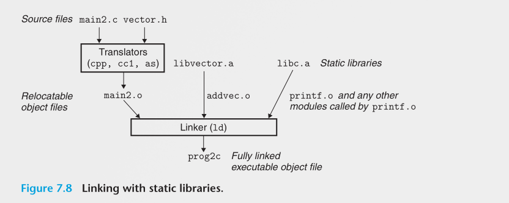
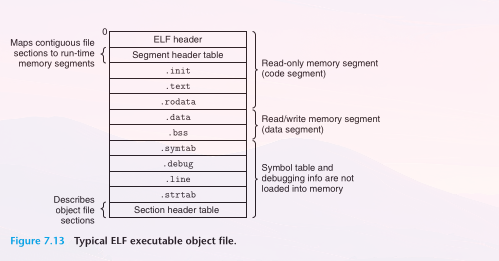
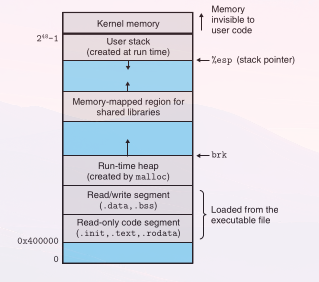

+++
date = '2026-10-22T22:59:03-03:00'
draft = false
title = 'Linking'
type = 'blog'
tags = ['Arquitetura', 'Sistemas Operacionais', 'Bibliotecas', 'Compiladores']
+++

*Linking* (ligação) é o processo de reunir e combinar vários pedaços de código e de dados em um único arquivo, que pode ser *carregado* (copiado) para a memória e executado. O linking pode acontecer em três momentos:

- **Em tempo de compilação** (*compile time*), quando o código-fonte é traduzido para código de máquina.
- **Em tempo de carregamento** (*load time*), quando o programa é carregado na memória e executado pelo *loader*.
- **Em tempo de execução** (*run time*), feito pelos próprios programas enquanto rodam.

Nos primeiros computadores, o linking era feito manualmente. Nos sistemas modernos, ele é feito automaticamente por programas chamados de **linkers**.

Os linkers têm um papel essencial no desenvolvimento de software porque permitem a **compilação separada**. Em vez de organizar uma aplicação grande em um único arquivo-fonte gigante, é possível dividi-la em módulos menores e mais fáceis de gerenciar, que podem ser modificados e compilados separadamente. **Quando um desses módulos muda, basta recompilar só ele e refazer o linking da aplicação, sem precisar recompilar todos os outros arquivos.**

Existem duas formas de fazer o linking:

- **Linking estático:** acontece na compilação. As bibliotecas são arquivos `.a`, uma coleção de relocatable object files (`.o`) empacotados em um só arquivo, e o linker copia para dentro do executável só os `.o` que o programa usa. O executável fica maior, mas é autossuficiente e não depende de nada para rodar.
- **Linking dinâmico:** o código das bibliotecas fica de fora do executável, em uma *shared library* (`.so` no Linux, `.dll` no Windows), e só é ligado ao programa quando ele é carregado ou enquanto roda. Vários programas podem usar a mesma cópia da biblioteca na memória, e atualizar a biblioteca não exige refazer o linking dos programas.

## O programa de exemplo

Ao longo do post, vamos usar como exemplo um programa formado por dois arquivos-fonte, `main.c` e `sum.c`. A função `main` inicializa um vetor de `int` e depois chama a função `sum` para somar os elementos do vetor.

**main.c**

```c
int sum(int *a, int n);

int array[2] = {1, 2};

int main()
{
    int val = sum(array, 2);
    return val;
}
```

**sum.c**

```c
int sum(int *a, int n)
{
    int i, s = 0;

    for (i = 0; i < n; i++) {
        s += a[i];
    }
    return s;
}
```

Repare que `main.c` só declara a função `sum` (na primeira linha), sem defini-la. A definição está em `sum.c`. Cada arquivo pode ser compilado separadamente, e é o linker que junta os dois em um único programa executável.

## Compiler drivers

A maioria dos sistemas de compilação tem um **compiler driver**, um programa que chama o pré-processador, o compilador, o montador (*assembler*) e o linker conforme necessário. No Linux, o driver é o próprio `gcc`. Para gerar o executável do nosso exemplo, basta um comando:

```
linux> gcc -Og -o prog main.c sum.c
```

Por trás dele, o driver passa cada arquivo-fonte pelas mesmas etapas, até chegar no executável. Para `main.c`, elas são:

| Etapa                 | Programa | Entrada → Saída       | O que faz                                          |
| --------------------- | -------- | --------------------- | -------------------------------------------------- |
| 1. Pré-processamento  | `cpp`    | `main.c` → `main.i`   | Expande `#include` e `#define`, remove comentários |
| 2. Compilação         | `cc1`    | `main.i` → `main.s`   | Traduz C para Assembly (em texto)                  |
| 3. Montagem           | `as`     | `main.s` → `main.o`   | Traduz o Assembly para código de máquina (binário) |
| 4. Linkagem           | `ld`     | `main.o` + `sum.o` → `prog` | Junta os objetos e resolve os endereços      |

As três primeiras etapas são feitas separadamente para cada arquivo, e o mesmo processo gera o `sum.o`. Os arquivos `.o` são chamados de **relocatable object files**: já são código de máquina, mas ainda não podem ser executados sozinhos. Na última etapa, o linker `ld` combina `main.o` e `sum.o`, junto com alguns object files do sistema, e cria o **executable object file** `prog`:

```
ld -o prog [object files do sistema e argumentos] /tmp/main.o /tmp/sum.o
```

Para rodar o programa, basta digitar o nome dele no terminal:

```
linux> ./prog
```

O shell chama uma função do sistema operacional chamada **loader** (carregador), que copia o código e os dados do arquivo `prog` para a memória e transfere o controle para o início do programa.

## Static linking

Um **linker estático**, como o `ld` do Linux, pega vários relocatable object files e junta tudo em um único executable object file, pronto para ser carregado e rodar. Cada object file é dividido em seções: uma com as instruções, outra com as variáveis globais inicializadas, outra com as não inicializadas, e assim por diante.

Para fazer isso, o linker tem duas tarefas:

1. **Resolução de símbolos:** símbolos são os nomes de funções, variáveis globais e variáveis `static`. Um arquivo pode *definir* um símbolo ou só *referenciá-lo*. O linker liga cada referência a exatamente uma definição. No exemplo, `main.c` referencia `sum`, e o linker encontra a definição em `sum.c`. Variáveis locais não entram nessa conta, a não ser que sejam declaradas como `static`: as comuns ficam na stack, e o linker nem sabe que elas existem.
2. **Relocação:** o compilador e o montador geram cada arquivo como se ele começasse no endereço 0, porque ainda não sabem onde ele vai ficar. O linker decide o endereço final de cada símbolo e corrige todas as referências para apontarem para lá. Ele faz isso seguindo instruções deixadas pelo montador, as *entradas de relocação*.

O ponto importante é que **o linker é bem simples**: para ele, um object file é só um conjunto de blocos de bytes (código, dados e informações para o linker e o loader). Ele junta os blocos, decide onde cada um fica na memória e ajusta os endereços. Quase todo o trabalho pesado já foi feito antes, pelo compilador e pelo montador.

## Object files

Existem três tipos de object file:

- **Relocatable object file:** código e dados binários que ainda vão ser combinados com outros relocatable object files para formar um executable object file. É o que o compilador e o montador geram (os `.o` do exemplo).
- **Executable object file:** código e dados prontos para serem copiados para a memória e executados. É o que o linker gera (o `prog`).
- **Shared object file:** um tipo especial de relocatable object file que pode ser carregado na memória e ligado dinamicamente, quando o programa é carregado ou durante a execução. São as bibliotecas compartilhadas, como os `.so` do Linux e as `.dll` do Windows.

O formato desses arquivos muda de sistema para sistema. Os primeiros Unix usavam o formato `a.out` (por isso até hoje o executável gerado pelo `gcc` sem `-o` se chama `a.out`). O Windows usa o **PE** (*Portable Executable*), o macOS usa o **Mach-O**, e o Linux e os Unix modernos usam o **ELF** (*Executable and Linkable Format*). O post segue o ELF, mas as ideias são as mesmas nos outros formatos.

### Relocatable object files no formato ELF

Um relocatable object file ELF começa com um **cabeçalho ELF**, termina com uma **tabela de cabeçalhos de seção**, e tem as seções no meio:

```
+-------------------------------+  0
| Cabeçalho ELF                 |
+-------------------------------+
| .text                         |
| .rodata                       |
| .data                         |
| .bss                          |
| .symtab                       |  Seções
| .rel.text                     |
| .rel.data                     |
| .debug                        |
| .line                         |
| .strtab                       |
+-------------------------------+
| Tabela de cabeçalhos de seção |  Descreve as seções
+-------------------------------+
```

O **cabeçalho ELF** diz o tamanho da palavra e a ordem dos bytes da máquina que gerou o arquivo, o tipo do arquivo (relocatable, executable ou shared object file), a arquitetura (x86-64, por exemplo) e onde fica a tabela de cabeçalhos de seção. Essa tabela, por sua vez, diz onde começa e qual o tamanho de cada seção.

As seções guardam o conteúdo do arquivo:

| Seção       | O que guarda                                                                 | No exemplo (`main.o`)            |
| ----------- | ---------------------------------------------------------------------------- | -------------------------------- |
| `.text`     | O código de máquina do programa                                              | O código da função `main`        |
| `.rodata`   | Dados somente leitura, como as strings de formato do `printf`                | (vazia)                          |
| `.data`     | Variáveis globais e `static` **inicializadas**                               | O vetor `array`, com `{1, 2}`    |
| `.bss`      | Variáveis globais e `static` **não inicializadas** (ou inicializadas com zero) | (vazia)                        |
| `.symtab`   | A tabela de símbolos: funções e variáveis globais definidas e referenciadas  | `main` e `array` (definidos), `sum` (referenciado) |
| `.rel.text` | Os pontos do `.text` que o linker vai ter que corrigir                       | A chamada a `sum` e o uso do endereço de `array` |
| `.rel.data` | Os pontos do `.data` que o linker vai ter que corrigir                       | (vazia)                          |
| `.debug`    | Informações para o depurador (só com `-g`)                                   |                                  |
| `.line`     | A relação entre as linhas do código C e as instruções (só com `-g`)          |                                  |
| `.strtab`   | Os nomes dos símbolos e das seções, como strings terminadas em nulo          | "main", "array", "sum"...        |

Alguns detalhes que valem destacar:

- **Variáveis locais não aparecem em nenhuma dessas seções.** Elas são criadas na stack durante a execução, então o linker não precisa saber delas. A variável `val` de `main`, por exemplo, não está em `.data` nem na tabela de símbolos.
- **A seção `.bss` não ocupa espaço no arquivo.** Como as variáveis dela começam todas com zero, não faz sentido guardar esses zeros no disco: o arquivo só registra quanto espaço elas precisam, e a memória é zerada quando o programa é carregado. O nome vem de uma diretiva do montador do IBM 704, de 1957 (*block started by symbol*), mas o livro sugere lembrar como *Better Save Space*.
- **Todo relocatable object file tem tabela de símbolos**, mesmo compilado sem `-g`. O `-g` só acrescenta as informações de depuração (`.debug` e `.line`).

## Símbolos e tabelas de símbolos

Um **símbolo** é um nome que aparece no nível global do código C: uma função ou uma variável global (ou `static`). No exemplo, `main`, `array` e `sum` são símbolos. Já as variáveis declaradas dentro das funções, como `val`, `i` e `s`, não são.

A **tabela de símbolos** é uma lista guardada dentro do próprio `.o`, na seção `.symtab`, que diz para cada nome:

- onde ele está (em qual seção e em qual posição dela);
- quantos bytes ocupa;
- o que ele é (função, variável...);
- se outros arquivos podem usá-lo.

Ela existe para o **linker**. Quando você junta vários `.o`, o linker usa essas tabelas para descobrir, por exemplo, que o `sum` chamado em `main.o` é o `sum` definido em `sum.o`.

Para entender os tipos de símbolo, é preciso saber o que é um **módulo**: é simplesmente um arquivo do programa. Cada `.c`, depois de compilado, vira um `.o`, e cada `.o` é um módulo (o livro chama de *object module*). No exemplo, o programa tem dois módulos: `main.o` e `sum.o`. Então, quando o texto diz "definido pelo módulo", quer dizer "definido **naquele arquivo**".

Para o linker, existem três tipos de símbolo, sempre olhando do ponto de vista de um módulo:

- **Globais definidos pelo módulo:** funções e variáveis globais que o arquivo define e que outros arquivos podem usar. No `main.o`, são `main` e `array`.
- **Externos:** funções e variáveis globais que o arquivo usa, mas que são definidas em outro arquivo. No `main.o`, é o `sum`.
- **Locais:** funções e variáveis globais declaradas com `static`. Elas só podem ser usadas dentro do próprio arquivo, e nenhum outro módulo consegue enxergá-las.

### `static` como "privado"

Em C, o `static` em uma variável global ou função faz o papel do `private` em Java ou C++: o arquivo é o módulo, e tudo o que é `static` fica escondido dentro dele. O que não é `static` é público e pode ser usado por qualquer outro arquivo. Por isso, é uma boa prática declarar como `static` tudo o que não precisa ser visto de fora.

### Símbolos locais não são variáveis locais

Um ponto que confunde: **símbolo local do linker não é o mesmo que variável local do programa**. As variáveis locais comuns (como `val`, `i` e `s` do exemplo) ficam na stack durante a execução e não aparecem na tabela de símbolos. O linker nem sabe que elas existem.

A exceção são as variáveis locais declaradas com `static`. Como precisam manter o valor entre uma chamada e outra, elas não ficam na stack: o compilador reserva espaço para elas em `.data` ou `.bss` e cria um símbolo local para cada uma. Se duas funções do mesmo arquivo tiverem uma variável `static` com o mesmo nome, o compilador dá nomes diferentes para cada uma:

```c
int f()
{
    static int x = 0;
    return x;
}

int g()
{
    static int x = 1;
    return x;
}
```

Aqui, o compilador cria dois símbolos locais, como `x.1` e `x.2`, um para cada `x`. Compilando no GCC atual, eles aparecem como `x.0` e `x.1`, mas a ideia é a mesma. O `x` de `f`, inicializado com 0, vai para `.bss`; o de `g`, inicializado com 1, vai para `.data`.

### Como é uma entrada da tabela de símbolos

A tabela de símbolos fica na seção `.symtab` e é um vetor de entradas com este formato:

```c
typedef struct {
    int   name;        /* Posição do nome na tabela de strings */
    char  type:4,      /* Função ou dado (4 bits) */
          binding:4;   /* Local ou global (4 bits) */
    char  reserved;    /* Não usado */
    short section;     /* Índice da seção */
    long  value;       /* Posição na seção ou endereço absoluto */
    long  size;        /* Tamanho do objeto em bytes */
} Elf64_Symbol;
```

- **`name`:** o nome não fica na entrada, e sim na seção `.strtab`. A entrada só guarda a posição dele lá.
- **`value`:** o endereço do símbolo. Em um relocatable object file, é a distância desde o início da seção onde o símbolo está, já que o endereço final ainda não existe. Em um executable object file, é o endereço real durante a execução.
- **`size`:** o tamanho em bytes.
- **`type`:** se o símbolo é uma função ou um dado.
- **`binding`:** se o símbolo é local ou global.
- **`section`:** em qual seção o símbolo está (`.text`, `.data`...).

Além das seções normais, existem três **pseudosseções**, que só aparecem em relocatable object files:

- **ABS:** símbolos que não devem ser relocados.
- **UNDEF:** símbolos usados no arquivo, mas definidos em outro lugar (os externos).
- **COMMON:** variáveis globais não inicializadas que ainda não receberam espaço.

### Resolução de símbolos

O linker liga cada referência a exatamente uma definição, procurando nas tabelas de símbolos dos object files. Para **símbolos locais** é fácil, porque a definição está no próprio módulo. Para **símbolos globais**, o compilador só assume que a definição está em outro módulo e deixa o problema para o linker. Se o linker não a encontra em nenhum arquivo, ele dá erro, como o `undefined reference to 'foo'` de uma função que foi declarada mas nunca definida.

O outro problema é quando vários módulos definem um símbolo global com o mesmo nome.

#### Símbolos com o mesmo nome: fortes e fracos

Cada símbolo global é **forte** (funções e variáveis globais inicializadas) ou **fraco** (variáveis globais não inicializadas). O linker segue três regras:

1. **Vários fortes com o mesmo nome:** erro (`multiple definition`).
2. **Um forte e vários fracos:** escolhe o forte.
3. **Vários fracos:** escolhe qualquer um.

As regras 2 e 3 são perigosas porque o linker escolhe **sem avisar**:

```c
/* foo3.c */
#include <stdio.h>
void f(void);

int x = 15213;

int main()
{
    f();
    printf("x = %d\n", x);
    return 0;
}
```

```c
/* bar3.c */
int x;

void f()
{
    x = 15212;
}
```

O `x` forte de `foo3.c` e o fraco de `bar3.c` viram a mesma variável, então `f` altera o `x` do `main` e o programa imprime 15212 em vez de 15213. Com tipos diferentes é pior: se um arquivo define `x` como `int` e o outro como `double`, a escrita de 8 bytes do `double` sobrescreve também a variável vizinha na memória. Para se proteger, o livro recomenda compilar com `-fno-common` ou `-Werror`.

É por isso que variáveis globais não inicializadas iam para COMMON: o compilador não sabe se outro módulo define a mesma variável e deixa a decisão para o linker. **Desde o GCC 10, o padrão é `-fno-common`**, então hoje esse exemplo dá `multiple definition of 'x'` em vez de escolher em silêncio. O comportamento do livro só aparece com `-fcommon`.

## Linking com bibliotecas estáticas

Até aqui, o linker recebia só os object files do próprio programa. Na prática, todo sistema também permite empacotar vários object files relacionados em um único arquivo, a **biblioteca estática** (*static library*), que também é passada para o linker. A vantagem é que o linker **copia para o executável só os módulos da biblioteca que o programa realmente usa**.

Um bom exemplo é a biblioteca padrão do C, a `libc.a`, que tem funções como `printf`, `scanf`, `strcpy` e `atoi`, e a `libm.a`, com funções matemáticas como `sin`, `cos` e `sqrt`. Sem bibliotecas estáticas, as alternativas seriam ruins:

- **O compilador reconhecer as funções padrão e gerar o código delas direto**, como o Pascal faz. No C, que tem muitas funções padrão, isso deixaria o compilador muito complicado, e cada mudança em uma função exigiria uma nova versão do compilador.
- **Colocar todas as funções em um único object file**, como um `libc.o`. Aí todo executável carregaria uma cópia da biblioteca inteira, desperdiçando disco e memória (a `libc.a` tem cerca de 5 MB), e qualquer mudança em uma função obrigaria a recompilar o arquivo todo.
- **Deixar cada função em um object file separado** e o programador passar ao linker cada um que usa, como `printf.o` e `scanf.o`. Funciona, mas é trabalhoso e fácil de errar.

**A biblioteca estática resolve tudo isso: cada função fica em um módulo separado, mas todos ficam juntos em um só arquivo.** No Linux, esse arquivo tem o formato **archive** (extensão `.a`): um conjunto de relocatable object files concatenados, com um cabeçalho que descreve onde está cada um. Basta passar a biblioteca para o linker:

```
linux> gcc main.c /usr/lib/libm.a /usr/lib/libc.a
```

(Na verdade, o `gcc` já passa a `libc.a` sozinho, então ela nem precisa aparecer no comando.)

O linker copia para o executável só os `.o` da biblioteca que o programa usa, e inteiros. No exemplo do livro, a biblioteca `libvector.a` tem os módulos `addvec.o` e `multvec.o`, e o programa `main2.c` usa só a função `addvec`, então só o `addvec.o` entra no executável:



## Relocação

Terminada a resolução de símbolos, cada referência já está ligada a uma única definição. Na relocação, o linker junta as seções do mesmo tipo de todos os módulos (todas as `.text` viram uma só, todas as `.data` também), decide o endereço de execução de cada seção e de cada símbolo e, por fim, corrige as referências no código para apontarem para esses endereços.

Para saber o que corrigir, o linker usa as **entradas de relocação** (`.rela.text` e `.rela.data`). O montador cria uma entrada sempre que encontra uma referência a algo cujo endereço final ele ainda não conhece. Cada entrada diz **onde** está a referência dentro da seção (*offset*), **a qual símbolo** ela se refere, **como** corrigir (*type*) e uma constante que entra no cálculo (*addend*). Os dois tipos básicos são:

- **`R_X86_64_PC32`:** endereço **relativo ao PC**, ou seja, a distância entre o símbolo e a instrução. É o usado pelo `call`.
- **`R_X86_64_32`:** endereço **absoluto** de 32 bits, usado diretamente.

### Relocando referências a símbolos

O linker percorre cada seção e cada entrada de relocação dela. Para cada entrada, ele acha o ponto da seção que precisa ser corrigido e escreve ali o valor certo, de acordo com o tipo:

- **Referência relativa ao PC:** o linker escreve a **distância** entre a instrução e o símbolo. Na execução, o processador soma essa distância ao PC e chega ao símbolo. O addend serve para compensar o fato de que, quando a instrução executa, o PC já aponta para a instrução seguinte.
- **Referência absoluta:** o linker escreve o **endereço** do símbolo direto, e a instrução o usa sem nenhum cálculo.

## Executable object files

Depois do linking, o programa, que começou como alguns arquivos de texto em C, virou um único arquivo binário com tudo o que é preciso para ser carregado na memória e rodar.



**O formato de um executable object file é parecido com o de um relocatable object file.** O cabeçalho ELF descreve o formato geral do arquivo e também guarda o **entry point**, o endereço da primeira instrução que vai ser executada quando o programa rodar. As diferenças em relação ao relocatable object file são:

- **As seções `.text`, `.rodata` e `.data` já foram relocadas** para os endereços que vão ter na memória durante a execução.
- **Existe uma seção `.init`**, com uma pequena função `_init`, chamada pelo código de inicialização do programa.
- **Não existem seções `.rel`**, porque o executável já está totalmente ligado e não há mais nada para corrigir.

O executável foi feito para ser fácil de carregar: pedaços contíguos do arquivo correspondem a pedaços contíguos da memória, os **segmentos**. Quem descreve essa correspondência é a **tabela de cabeçalhos de programa** (*program header table*), que dá para ver com `objdump -p`. No exemplo, ela tem dois segmentos:

- **Segmento de código** (leitura e execução): contém o cabeçalho ELF, a tabela de cabeçalhos de programa e as seções `.init`, `.text` e `.rodata`.
- **Segmento de dados** (leitura e escrita): contém a seção `.data` e a `.bss`. A `.bss` não ocupa espaço no arquivo, então a parte do segmento que corresponde a ela é preenchida com zeros quando o programa é carregado.

As seções `.symtab`, `.debug`, `.line` e `.strtab` ficam no arquivo, mas **não são carregadas na memória**.

Para cada segmento, o linker escolhe um endereço inicial que fique **alinhado** com a posição do segmento dentro do arquivo: os dois precisam ter o mesmo resto na divisão pelo alinhamento indicado no cabeçalho, que no exemplo é 2 MB. Isso é uma otimização que permite copiar os segmentos do arquivo para a memória de forma eficiente, por causa do jeito como a memória virtual é organizada, em blocos grandes e contíguos com tamanho potência de 2 (assunto do capítulo 9).

## Carregando executable object files

Para rodar um executable object file, basta digitar o nome dele no shell:

```
linux> ./prog
```

**Como `prog` não é um comando embutido do shell, o shell assume que é um executable object file e o roda chamando o *loader*, um código do sistema operacional que fica sempre na memória.** Qualquer programa do Linux pode chamar o loader usando a função `execve`. **O loader copia o código e os dados do executável do disco para a memória e então roda o programa, pulando para a primeira instrução, o *entry point*. Esse processo de copiar o programa para a memória e rodá-lo é o que se chama de *carregamento* (*loading*).**

Todo programa no Linux x86-64 roda com uma imagem de memória parecida com esta:



De baixo para cima:

- **Segmento de código** (`.init`, `.text`, `.rodata`), que começa no endereço `0x400000`, e logo acima o **segmento de dados** (`.data`, `.bss`). Os dois vêm do executável.
- **Heap**, que cresce para cima conforme o programa chama `malloc`.
- **Região das shared libraries.**
- **Stack do usuário**, que começa no maior endereço permitido ao programa (2⁴⁸ − 1) e cresce para baixo.
- **Memória do kernel**, acima de tudo, que o programa não consegue acessar.

Quando o loader roda, ele cria uma imagem de memória parecida com a da figura. Guiado pela tabela de cabeçalhos de programa, ele copia pedaços do executable object file para os segmentos de código e de dados. Em seguida, o loader pula para o entry point do programa, que é sempre o endereço da função `_start`. Essa função é definida no object file de sistema `crt1.o` e é a mesma para todos os programas em C. A `_start` chama a *função de inicialização do sistema* (*system startup function*), a `__libc_start_main`, que é definida na `libc.so`. Ela inicializa o ambiente de execução, chama a função `main` do programa, trata o valor que ela retorna e, se necessário, devolve o controle ao kernel.

### Os endereços mudam a cada execução (ASLR)

A figura mostra as regiões encostadas umas nas outras, mas na prática existem espaços entre elas, em parte por causa do alinhamento dos segmentos. O motivo principal, porém, é o **ASLR** (*address-space layout randomization*): **a cada execução, o sistema sorteia onde ficam a stack, o heap e as shared libraries.** Rodar o mesmo programa duas vezes dá endereços diferentes.

Isso é uma defesa de segurança. Muitos ataques, como os de *buffer overflow*, dependem de saber de antemão em que endereço está um certo código ou dado na memória. Com os endereços sorteados, o atacante não tem como adivinhar para onde pular.

O que **não** muda é a organização: a ordem das regiões é sempre a mesma, e o código e os dados continuam na mesma posição um em relação ao outro. Só o ponto de partida de cada região é que muda.

Hoje o sorteio vai além do que o livro mostra. O GCC atual gera executáveis **PIE** (*position-independent executable*) por padrão, então até o segmento de código muda de lugar, em vez de começar sempre em `0x400000`. Imprimindo o endereço de `main`, de uma variável global, de um `malloc`, do `printf` e de uma variável local, em duas execuções seguidas:

```
codigo 0x5a13f76d0159  dados 0x5a13f76d3020  heap 0x5a1403f5b010  lib 0x7f6079c5b8b0  stack 0x7ffc2d9f5b44
codigo 0x599d32fce159  dados 0x599d32fd1020  heap 0x599d4411a010  lib 0x7c6c1365b8b0  stack 0x7ffd26edd074
```

Todos os endereços mudaram, mas a distância entre o código e os dados continua igual (`0x2ec7`). Compilando com `-no-pie`, o código volta a ficar fixo em `0x401156`, perto do `0x400000` do livro, e só o heap, as bibliotecas e a stack continuam mudando.

### Como o loader funciona de verdade

A descrição acima é simplificada. Na prática, cada programa roda em um **processo**, com seu próprio espaço de endereçamento virtual. Quando você roda `./prog`, o shell cria um processo filho, uma cópia de si mesmo, e esse filho chama o `execve`, que aciona o loader. O loader apaga os segmentos de memória virtual que o processo tinha e cria novos segmentos de código, dados, heap e stack, com a stack e o heap zerados. Os segmentos de código e dados são **mapeados** para pedaços do executable object file, sem copiar nada: os dados só são trazidos do disco para a memória quando o processador acessa aquela página pela primeira vez, pelo mecanismo de paginação do sistema operacional (assunto do capítulo 9).

## Dynamic linking com shared libraries

As bibliotecas estáticas ainda têm dois problemas:

- **Atualização:** quando sai uma versão nova de uma biblioteca, todo programa que a usa precisa refazer o linking com ela de propósito. Se ninguém fizer isso, o programa continua com a versão antiga.
- **Desperdício:** quase todo programa usa funções como `printf` e `scanf`, e o código delas é copiado para cada executável. Em um sistema rodando centenas de processos, isso significa centenas de cópias iguais desse código na memória.

As **shared libraries** resolvem os dois. Uma shared library é um módulo que pode ser carregado em qualquer endereço da memória, na hora de carregar o programa ou durante a execução, e ser ligado a ele ali. Esse processo é o **dynamic linking**, e quem faz é o **dynamic linker**. No Linux, as shared libraries são os **shared object files** (`.so`); no Windows, as DLLs.

Elas são "compartilhadas" de duas formas:

- **No disco:** existe um único `.so` para cada biblioteca, e todos os executáveis que a usam apontam para ele, sem copiar o código para dentro de si.
- **Na memória:** uma única cópia da `.text` da biblioteca é usada por todos os processos que estão rodando.

Para criar uma shared library e usá-la:

```
linux> gcc -shared -fpic -o libvector.so addvec.c multvec.c
linux> gcc -o prog21 main2.c ./libvector.so
```

O `-fpic` gera **código independente de posição** (*position-independent code*), que funciona em qualquer endereço, e o `-shared` diz para criar um shared object file.


A ideia é fazer **parte do linking na criação do executável e terminar o resto quando ele é carregado**. Nenhum código ou dado da `libvector.so` é copiado para o `prog21`: o linker só copia informações de relocação e da tabela de símbolos, para que as referências à biblioteca possam ser resolvidas depois.

Quando o loader carrega o `prog21`, ele percebe que o executável tem uma seção `.interp`, com o caminho do dynamic linker (no Linux, o `ld-linux.so`, que também é um shared object file). Em vez de passar o controle direto para o programa, o loader roda o dynamic linker, que termina o linking:

1. Reloca o código e os dados da `libc.so` em um segmento da memória.
2. Reloca o código e os dados da `libvector.so` em outro segmento.
3. Reloca as referências do `prog21` aos símbolos definidos nessas bibliotecas.

Por fim, o dynamic linker passa o controle para o programa. A partir daí, as shared libraries ficam em endereços fixos até o programa terminar.

## Carregando e ligando shared libraries a partir do programa

Até aqui, o dynamic linker carregava as shared libraries quando o programa era carregado, logo antes de começar a rodar. Mas também dá para o **próprio programa pedir, durante a execução**, que o dynamic linker carregue e ligue uma shared library qualquer, sem que ela tenha sido ligada ao programa na compilação. Dois usos reais:

- **Distribuir atualizações:** programas para Windows costumam ser atualizados trocando uma shared library pela versão nova. Na próxima vez que o programa roda, ele carrega a nova automaticamente.
- **Servidores web rápidos:** os primeiros servidores geravam conteúdo dinâmico (páginas personalizadas, saldos de conta, anúncios) criando um processo filho com `fork` e `execve` a cada requisição. Os modernos colocam cada função que gera conteúdo em uma shared library. Quando chega uma requisição, o servidor carrega a função certa e a chama diretamente. Ela fica guardada no espaço de endereçamento do servidor, então as próximas requisições custam só uma chamada de função. Também dá para atualizar ou acrescentar funções sem parar o servidor.

No Linux, isso é feito com quatro funções da `<dlfcn.h>`:

- **`dlopen(filename, flag)`:** carrega e liga a shared library `filename` e devolve um *handle* para ela (ou NULL, se der erro). O `flag` diz quando resolver os símbolos externos: `RTLD_NOW` resolve na hora e `RTLD_LAZY` só quando o código da biblioteca for executado.
- **`dlsym(handle, symbol)`:** devolve o endereço do símbolo `symbol` dentro da biblioteca aberta, ou NULL se ele não existir.
- **`dlclose(handle)`:** descarrega a biblioteca, se nenhuma outra estiver usando.
- **`dlerror()`:** devolve uma mensagem descrevendo o último erro dessas funções, ou NULL se não houve erro.

O programa abaixo carrega a `libvector.so` durante a execução e chama a `addvec`:

```c
/* dll.c */
#include <stdio.h>
#include <stdlib.h>
#include <dlfcn.h>

int x[2] = {1, 2};
int y[2] = {3, 4};
int z[2];

int main()
{
    void *handle;
    void (*addvec)(int *, int *, int *, int);
    char *error;

    /* Carrega a shared library que contém addvec() */
    handle = dlopen("./libvector.so", RTLD_LAZY);
    if (!handle) {
        fprintf(stderr, "%s\n", dlerror());
        exit(1);
    }

    /* Pega um ponteiro para a função addvec() */
    addvec = dlsym(handle, "addvec");
    if ((error = dlerror()) != NULL) {
        fprintf(stderr, "%s\n", error);
        exit(1);
    }

    /* Agora addvec() pode ser chamada como qualquer outra função */
    addvec(x, y, z, 2);
    printf("z = [%d %d]\n", z[0], z[1]);

    /* Descarrega a shared library */
    if (dlclose(handle) < 0) {
        fprintf(stderr, "%s\n", dlerror());
        exit(1);
    }
    return 0;
}
```

Para compilar:

```
linux> gcc -rdynamic -o prog2r dll.c -ldl
```

O `-rdynamic` deixa os símbolos globais do próprio executável disponíveis para as bibliotecas abertas com `dlopen`, e o `-ldl` liga a biblioteca que tem essas funções. Nas versões atuais da glibc, elas já fazem parte da `libc`, então o `-ldl` não é mais necessário, mas continua funcionando.

## Position-independent code (PIC)

O objetivo das shared libraries é que vários processos usem **a mesma cópia** do código na memória. Uma forma de fazer isso seria reservar para cada biblioteca um pedaço fixo do espaço de endereçamento e sempre carregá-la ali. Só que isso desperdiça espaço (o pedaço fica reservado mesmo quando o processo não usa a biblioteca) e é difícil de administrar: os pedaços não podem se sobrepor, cada versão nova precisa caber no seu lugar, e com centenas de bibliotecas o espaço acaba cheio de buracos inúteis.

A solução dos sistemas modernos é compilar o código das shared libraries de forma que ele **possa ser carregado em qualquer endereço sem que o linker precise modificá-lo**. Esse é o **position-independent code** (PIC), gerado com a opção `-fpic` do `gcc`. Assim, uma única cópia do segmento de código pode ser usada por quantos processos forem necessários (cada processo continua tendo a própria cópia do segmento de dados).

Referências a símbolos do próprio módulo já são PIC naturalmente, porque usam endereçamento relativo ao PC. O problema são as referências a variáveis globais e funções que podem estar **em outro módulo**.

### Referências a dados: a GOT

O truque é que, onde quer que o módulo seja carregado, **o segmento de dados fica sempre à mesma distância do segmento de código**. Então o compilador cria, no início do segmento de dados, a **GOT** (*global offset table*), uma tabela com uma entrada de 8 bytes para cada variável ou função global que o módulo usa. O código acessa a GOT com endereçamento relativo ao PC, que funciona em qualquer posição. Na hora de carregar, o dynamic linker preenche cada entrada da GOT com o endereço real do objeto. O código nunca é alterado: só a GOT, que fica nos dados.

### Chamadas de função: lazy binding com a PLT

Para chamadas a funções de shared libraries, o GCC usa o **lazy binding**: o endereço de cada função só é resolvido **na primeira vez que ela é chamada**. Faz sentido porque um programa costuma usar só algumas das milhares de funções de uma biblioteca como a `libc.so`, então resolver todas no carregamento seria desperdício. A primeira chamada é mais lenta, mas as seguintes custam só um desvio a mais.

Isso funciona com duas tabelas: a GOT e a **PLT** (*procedure linkage table*), que fica no segmento de código e tem uma pequena entrada de código para cada função de biblioteca que o programa chama. O programa nunca chama a função direto, e sim a entrada dela na PLT, que pula para o endereço guardado na GOT:

- **Na primeira chamada**, a entrada da GOT ainda aponta de volta para a PLT. A PLT então chama o dynamic linker, que descobre o endereço real da função, **escreve esse endereço na GOT** e passa o controle para a função.
- **Nas chamadas seguintes**, a GOT já tem o endereço certo, e o pulo da PLT vai direto para a função.

## Library interpositioning

O **library interpositioning** é uma técnica que permite **interceptar chamadas a funções de shared libraries e rodar outro código no lugar**. Com ela, dá para contar quantas vezes uma função é chamada, registrar os argumentos e o retorno dela, ou trocá-la por uma implementação completamente diferente.

A ideia é criar uma **função wrapper** com o mesmo protótipo da função alvo e enganar o sistema para que ele chame o wrapper em vez dela. O wrapper normalmente faz o que precisa, chama a função original e devolve o resultado. O livro usa como exemplo um programa que chama `malloc` e `free`, e o objetivo é imprimir cada chamada. Isso pode ser feito em três momentos:

- **Na compilação:** um `malloc.h` local define macros que trocam `malloc` e `free` por `mymalloc` e `myfree`. Compilando com `-I.`, o pré-processador usa esse arquivo antes do do sistema. Exige ter o código-fonte do programa.
- **No linking:** a opção `--wrap f` do linker faz as referências a `f` irem para `__wrap_f`, e as referências a `__real_f` irem para a `f` original. Com o `gcc`, fica `-Wl,--wrap,malloc`. Exige ter os relocatable object files.
- **Na execução:** a variável de ambiente **`LD_PRELOAD`** faz o dynamic linker procurar primeiro nas bibliotecas listadas nela, antes de qualquer outra. Basta criar uma shared library com as próprias versões de `malloc` e `free`, que acham a original com `dlsym(RTLD_NEXT, "malloc")`. Exige só o executável, então **funciona com qualquer programa**, até os do sistema:

```
linux> LD_PRELOAD="./mymalloc.so" /usr/bin/uptime
```

## Ferramentas para manipular object files

O Linux tem várias ferramentas para entender e mexer em object files. A maioria vem do pacote **GNU binutils**, disponível em qualquer distribuição:

- **`ar`:** cria bibliotecas estáticas e insere, remove, lista e extrai os módulos delas.
- **`strings`:** lista todas as strings imprimíveis de um object file.
- **`strip`:** apaga a tabela de símbolos de um object file.
- **`nm`:** lista os símbolos definidos na tabela de símbolos.
- **`size`:** lista os nomes e os tamanhos das seções.
- **`readelf`:** mostra a estrutura completa de um object file, inclusive tudo o que está no cabeçalho ELF. Faz tudo o que o `size` e o `nm` fazem.
- **`objdump`:** a "mãe de todas as ferramentas binárias". Mostra qualquer informação de um object file, e o uso mais comum é desmontar as instruções da seção `.text`.

Para shared libraries, existe também o **`ldd`**, que lista as shared libraries de que um executável precisa para rodar.

## Resumo

- **Object file:** é o arquivo que o compilador gera a partir de um `.c`. Ele já tem o código em linguagem de máquina, mas ainda não é um programa pronto. Cada object file também é chamado de **módulo**: no exemplo deste post, `main.o` e `sum.o` são dois módulos.
- **Tipos de object file:**
  - **Relocatable object file** (`.o`): gerado pelo compilador, ainda precisa ser juntado com outros para virar um programa.
  - **Executable object file**: o programa pronto, gerado pelo linker, que pode ser carregado na memória e executado.
  - **Shared object file** (`.so` no Linux, `.dll` no Windows): uma biblioteca que é ligada ao programa só na hora de carregar ou durante a execução.
- **O que tem dentro de um object file:** o código de máquina (`.text`), as variáveis globais inicializadas (`.data`) e não inicializadas (`.bss`), a **tabela de símbolos** (`.symtab`) e as informações de relocação (`.rel.text`, `.rel.data`), que dizem ao linker o que corrigir.
- **Carregar x executar:** **carregar** é copiar o código e os dados do executable object file do disco para a memória, preparando tudo para o programa começar. Quem faz isso é o **loader**, uma parte do sistema operacional. **Executar** é o que vem depois: o processador começa a rodar as instruções que já estão na memória, a partir da primeira instrução do programa. Ou seja, carregar é colocar o programa na memória, e executar é rodar o programa que já está lá.
- **Símbolo:** o nome de uma função ou variável global (ou `static`). Variáveis locais comuns não são símbolos. Do ponto de vista de um módulo, existem três tipos:
  - **Globais:** definidos no módulo e visíveis para os outros (`main` e `array` em `main.o`).
  - **Externos:** usados no módulo, mas definidos em outro (`sum` em `main.o`).
  - **Locais:** declarados com `static`, visíveis só dentro do próprio módulo.
  - Os globais também podem ser **fortes** (funções e variáveis inicializadas) ou **fracos** (variáveis não inicializadas), o que decide qual definição o linker escolhe quando há nomes repetidos.
- **O que o linker faz:** junta os módulos em um executável em duas etapas. Na **resolução de símbolos**, liga cada nome usado à sua definição, que pode estar em outro módulo. Na **relocação**, decide o endereço final de cada coisa e corrige todas as referências.
- **Biblioteca estática** (`.a`): um pacote com vários relocatable object files, como a `libc.a`. O linker copia para o executável só os módulos que o programa usa. Como o linker lê os arquivos da esquerda para a direita, **as bibliotecas devem vir no fim do comando**, depois dos arquivos que usam as funções delas.
- **Relocação:** para cada referência cujo endereço não conhece, o montador deixa uma **entrada de relocação**. Depois de decidir os endereços, o linker usa essas entradas para corrigir o código: referências **relativas ao PC** (como o `call`) recebem a distância até o símbolo, e referências **absolutas** recebem o endereço dele.
- **Executable object file:** tem formato parecido com o do relocatable object file, mas já está relocado, não tem seções `.rel` e o cabeçalho ELF guarda o **entry point**, o endereço da primeira instrução. A **tabela de cabeçalhos de programa** diz quais partes do arquivo viram os segmentos de código e de dados na memória.
- **Carregamento:** ao rodar `./prog`, o shell chama o **loader**, que copia o código e os dados do executável para a memória e pula para o entry point (`_start`), que acaba chamando o `main`. Na memória, o programa fica organizado em segmento de código, segmento de dados, heap, shared libraries e stack, com o kernel no topo. Por causa do **ASLR**, os endereços dessas regiões mudam a cada execução, o que dificulta ataques, mas a ordem delas é sempre a mesma.
- **Dynamic linking:** com **shared libraries** (`.so`), o código da biblioteca não é copiado para o executável. O linker faz só parte do trabalho, e o **dynamic linker** (`ld-linux.so`) termina o linking quando o programa é carregado. Assim, uma única cópia da biblioteca no disco e na memória serve a todos os programas, e atualizá-la não exige refazer o linking deles.
- **Carregar shared libraries durante a execução:** o próprio programa pode abrir uma shared library enquanto roda, com `dlopen`, pegar o endereço de uma função com `dlsym` e chamá-la. É assim que servidores web carregam funções sob demanda e programas recebem atualizações só trocando a biblioteca.
- **PIC:** código compilado com `-fpic`, que funciona em qualquer endereço sem ser modificado, e por isso uma única cópia pode ser usada por todos os processos. Variáveis e funções de outros módulos são acessadas pela **GOT**, uma tabela no segmento de dados que o dynamic linker preenche. Nas funções, o endereço só é resolvido na primeira chamada (**lazy binding**), através da **PLT**.
- **Library interpositioning:** interceptar chamadas a funções de bibliotecas com um **wrapper**, na compilação (macros), no linking (`--wrap`) ou na execução (`LD_PRELOAD`), que funciona com qualquer executável.
- **Ferramentas:** `ar` (bibliotecas estáticas), `strings`, `strip`, `nm` (símbolos), `size` (seções), `readelf` e `objdump` (estrutura completa e desmontagem do código), e `ldd` (shared libraries de que um executável precisa).

---

*Resumo do capítulo Linking do livro Computer Systems: A Programmer's Perspective (CSAPP), de Randal E. Bryant e David R. O'Hallaron, compilado pelo Claude*
