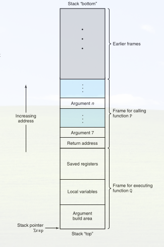
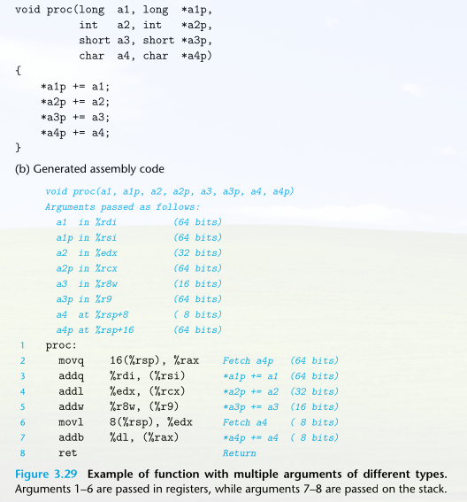

+++
date = '2026-10-17T12:31:52-03:00'
draft = false 
title = 'Procedimento e a Running-Stack'
type = 'blog'
tags = ['Arquitetura', 'Assembly', 'Memória', 'CSAPP']
+++

Procedimentos são abstrações em software. Promovem uma maneira de empacotar código que implementa certa funcionalidade. Recebe ou não argumentos e pode ou não retornar algo.

Toda ação de chamada de um procedimento envolve um ou mais dos seguintes mecanismos:

*(Para o restante do texto, suponha que o procedimento P chama o procedimento Q, e que Q então executa e retorna para P)*

- *Passagem de controle*: O contador de programa (PC) deve receber o endereço inicial do código de Q na entrada. No retorno, deve receber o endereço da instrução de P que vem logo após a chamada de Q

- *Passagem de dados*: P deve ser capaz de fornecer um ou mais parâmetros para Q, e Q deve ser capaz de retornar um valor para P.

- *Alocação e desalocação de memória*: Q pode precisar alocar espaço para variáveis locais quando começa e depois liberar esse espaço antes de retornar.

---

## Run-Time stack 

  
A estrutura de dados Stack, que é feita a partir do LIFO (Last-in, First-out), é usado para chamada de procedimentos. Quando o procedimento P chama o procedimento Q, ele fica temporariamente suspenso e só será finalizado quando Q e todas as suas chamadas subsequentes forem finalizadas. Enquanto Q está rodando, só ele vai precisar alocar novo espaço para suas variáveis locais ou  preparar uma chamada a outro procedimento. Quando Q retorna, qualquer espaço local que ele alocou pode ser liberado.

A pilha e o registradores do programa guardam as informações necessárias para passar controle e dados e para alocar memória. Quando P chama Q, informações de controle e de dados são adicionadas ao final da pilha. Essas informações são desalocadas quando P retorna .

A pilha começa nos endereços mais altos e cresce "para baixo", para endereços menores. Conforme o programa executa, a pilha cresce e diminui conforme é feito chamadas e retornos de procedimento. O registrador RSP aponta para o topo da pilha. Para aumentar ou diminuir a pilha, basta somar ou subtrair de RSP. Ex: RSP + 8 diminui a pilha e RSP - 8 aumenta a pilha. 

Quando um procedimento x86_64 precisa de mais armazenamento do que cabe nos registradores, ele aloca espaço na pilha. Essa região é chamada de -Stack frame- (quadro de pilha) do procedimento. A pilha pode ser usada para passar argumentos, guardar informações de retorno, salvar registradores e armazenar dados locais. Parte delas podem ser omitidas quando não são necessárias. 

Os stack frame da maioria dos procedimentos têm tamanho fixo e são alocados no início do procedimento. Alguns procedimentos, porém, precisam de quadros de tamanho variável. O procedimento P pode passar até seis valores inteiros (isto é, ponteiros e inteiros) para Q em registradores, sem a necessidade de acessar a memória! Se Q precisar de mais argumentos, P pode guarda-los no seu próprio stack-frame antes da chamada.

Para economizar espaço e tempo, os procedimentos x86_64 alocam apenas as partes do stack frame de que precisam. Por exemplo, muitos procedimentos têm seis argumentos ou menos, e então todos os seus parâmetros podem ser passados em registradores. Assim, partes do stack-frame mostrado na figura acima podem ser omitidos. *Isso acontece quando todas as variáveis locais cabem em registradores e a função não chama nenhuma outra função*

O compilador tenta manter as variáveis locais em registradores, porque é mais rápido que acessar a memória. Elas só vão para o stack frame quando não tem outro jeito.

## Control transfer 

Passar o controle da função P para a função Q envolve atualizar o Program Counter (PC) para o endereço inicial do código de Q. Porém, quando Q retornar, o processador precisa ter algum registro do local onde deve continuar a execução de P. Nas máquinas x86_64, essa informação é registrada chamando o procedimento Q com a instrução call Q. Essa instrução empilha um endereço A e coloca no PC o início de Q. O endereço empilhado A é chamado de endereço de retorno e é calculado como o endereço da instrução que vem logo depois da instrução call. A instrução correspondente, ret, desempilha um endereço A e coloca A no PC

## Data transfer

Chamadas de procedimento podem envolver passagem de dados como argumentos e também retorno de dados, caso haja. Nas máquinas x86_64, a maioria dessas passagens de dado *from and to* é feita através dos registradores.

Quando P chama o procedimento Q, o código de P precisa copiar os argumentos para os registradores corretos. Da mesma forma, quando Q retorna para P, o código de P pode acessar o valor retornado no registrador RAX. 

No x86_64, até seis argumentos inteiros (isto é, inteiros e ponteiros) podem ser passados por registradores. Os registradores são usados numa ordem definida, e o nome usado para cada registrador depende do tamanho do tipo de dado que está sendo passado. Argumentos são atribuídos a esses registradores de acordo com sua ordem na lista de argumento. Argumentos menores que 64 bits podem ser acessados usando a seção apropriada do registrador de 64 bits. 

*Quando uma função possui mais de 6 argumentos inteiros, os outros são passados pela stack.*

## Armazenamento local na Stack 

Normalmente, o compilador guarda variáveis locais em registradores, que são mais rápidos. Como visto anteriormente, até 6 argumentos. Após isso é usado a stack. Porém, há necessidade também de acessar memória para certos casos: 

- Não há registradores suficientes para armazenar os dados locais do procedimento 

- É usado o operador '&' em uma variável local e, portanto, é necessário trabalhar com endereço. Exemplo: &variavel, essa variável precisa estar na memória, porque o endereço vai ser passado para outra função

- Variáveis locais do tipo array e structs precisam ser acessados via referência, portanto necessitam da memória.

Tipicamente, um procedimento aloca espaço no stack frame decrementando o stack pointer. Há uma porção do stack frame dedicada para as variáveis locais, chamado "Local variables". O espaço é liberado somando o mesmo valor de volta ao final. Exemplo: Um procedimento caller que subtrai 16 do registrador de pilha RSP para guardar duas variáveis de 8 bytes. 

O ponto principal é que alocar e liberar memória da stack custa uma subtração e uma soma do registrador de pilha. O espaço existe só enquanto a função está executando e some sozinho quando ela termina.

Vale lembrar: Em C, toda passagem é por valor. Passagem por referência é na verdade passar um ponteiro por valor

## Armazenamento local em registradores 

Essa seção trata de um problema que aparece quando um procedimento chama outro: existe só um conjunto de registradores, e os dois procedimentos usam os mesmos.

Por convenção, registradores rbx, rbp, e r12-r15 são classificados como *callee-saved* registers. Quando o procedimento P chama o procedimento Q, Q DEVE preservar os valores desses registradores, assegurando que eles possuem os mesmos valores quando Q retornar para P, quando P chamou Q

Existem duas formas de Q (o procedimento que foi chamado após P), de preservar esses registradores. O primeiro é simplesmente não alterando esses registradores. O segundo é fazendo um push na stack e depois um pop do valor antigo, antes do retorno. Ao fazer um push, é criado a parte dos registradores salvos do stack-frame 

Todos os outros registradores, tirando o rsp, podem ser alterados livremente pelos procedimentos. 

---
*Trechos extraídos do livro CSAPP*
